# PICCOLINE Mikro-Logo — Brugervejledning (April 1985)

> **Originaltitel:** PICCOLINE – Mikro-Logo – Brugervejledning  
> **Udgave:** April 1985  
> **Udgiver:** A/S Regnecentralen af 1979 / RC Computer A/S, København  
> **Part Number (PN):** 99000852 / RCSL Nr.: 29 0 00852  
> **Nøgleord:** Logo, Mikro-Logo, PICCOLINE, Partner  
> **Resumé:** Denne manual beskriver Mikro-Logo på PICCOLINE og Partner mikrodatamater.

---

<!-- Titelblad -->
<div align="center">

# PICCOLINE
## Mikro-Logo
### Brugervejledning


**A/S Regnecentralen af 1979**  
PN: 99000852

</div>

---

<!-- Rygmærke -->
## Rygmærke {#sektion-rygmaerke}

```
PICCOLINE    Mikro-Logo    Brugervejledning    99000852
```

---

<!-- Fanebladsoversigt -->
## Fanebladsoversigt {#sektion-fanebladsoversigt}

* **Indledning**
* **Introduktion til Logo**
* **Skærmen**
* **Sætninger**
* **Kommandoer**
* **Overvågning af udførelse af sætninger**
* **Forskelle til Mikro-Logo på Piccolo**
* **Distributionsdisketten**
* **Læsevejledning for nybegyndere**
* **ASCII tegnsættet**
* **Fejlmeddelelser**
* **Oversigt over sætninger og kommandoer**
* **Registre**

---

<!-- Kolofon -->
## Kolofon {#sektion-kolofon}

**Nøgleord:** Logo, Mikro-Logo, PICCOLINE, Partner  
**Resumé:** Denne manual beskriver Mikro-Logo på PICCOLINE og Partner mikrodatamater.  
**Udgave:** april 1985  

Copyright © 1985 A/S Regnecentralen af 1979  
RC Computer A/S  
Udgivet af A/S Regnecentralen af 1979, København  

Brugere af denne manual gøres opmærksom på, at specifikationerne heri uden forudgående varsel kan ændres af RC. RC er ikke ansvarlig for typografiske fejl eller regnefejl, som kan forekomme i denne manual, og er ikke ansvarlig for skader forårsaget af benyttelsen af dette dokument.

---

<!-- Side i -->
## INDHOLDSFORTEGNELSE

| Afsnit | Emne | Side |
| :--- | :--- | :--- |
| **1.** | **INDLEDNING** | [1](#side-1) |
| **2.** | **INTRODUKTION TIL LOGO** | [2](#side-2) |
| **3.** | **SKÆRMEN** | [3](#side-3) |
| **4.** | **SÆTNINGER** | [7](#side-7) |
| 4.1 | Variable og udtryk | [8](#side-8) |
| 4.1.1 | Variable | [8](#side-8) |
| 4.1.2 | Udtryk | [8](#side-8) |
| 4.2 | Tegnesætninger | [12](#side-12) |
| 4.2.1 | Position | [12](#side-12) |
| 4.2.2 | Retning | [14](#side-14) |
| 4.2.3 | Pentype | [15](#side-15) |
| 4.2.4 | Andre sætninger til skildpadden | [15](#side-15) |
| 4.2.5 | Eksempler med simple tegninger | [17](#side-17) |
| 4.3 | Tildelings-, indlæsnings- og udskrivningssætninger | [22](#side-22) |
| 4.3.1 | Tildelingssætninger | [22](#side-22) |
| 4.3.2 | Indlæsningssætninger | [22](#side-22) |
| 4.3.3 | Udlæsningssætninger | [23](#side-23) |
| 4.4 | Kontrolsætninger | [24](#side-24) |
| 4.4.1 | Procedurekald | [24](#side-24) |
| 4.4.2 | Betingelsessætninger | [26](#side-26) |
| 4.4.3 | Gentagelsessætninger | [27](#side-27) |
| 4.4.4 | Definition af procedurer | [28](#side-28) |
| **5.** | **KOMMANDOER** | [31](#side-31) |
| 5.1 | Procedurekommandoer | [32](#side-32) |
| 5.1.1 | Definition af procedurer | [32](#side-32) |
| 5.1.2 | Administration af procedurer | [36](#side-36) |
| 5.2 | Diskettekommandoer | [37](#side-37) |
| 5.3 | Tegning på andre medier | [39](#side-39) |
| 5.4 | Andre kommandoer | [41](#side-41) |
| **6.** | **OVERVÅGNING AF UDFØRELSE AF SÆTNINGER** | [43](#side-43) |

<!-- Side ii -->
### BILAG:

| Bilag | Emne | Side |
| :--- | :--- | :--- |
| **A.** | **FORSKELLE TIL MIKRO-LOGO PÅ PICCOLO** | [45](#side-45) |
| A.1 | Sætninger | [45](#side-45) |
| A.2 | Kommandoer | [46](#side-46) |
| **B.** | **DISTRIBUTIONSDISKETTEN** | [48](#side-48) |
| B.1 | Polygon | [49](#side-49) |
| B.2 | Stjerne | [51](#side-51) |
| B.3 | Spiral | [52](#side-52) |
| B.4 | Kasse | [54](#side-54) |
| **C.** | **LÆSEVEJLEDNING FOR BEGYNDERE** | [58](#side-58) |
| C.1 | Opstart | [58](#side-58) |
| C.2 | Simpel brug af Mikro-Logo | [59](#side-59) |
| **D.** | **ASCII TEGNSÆTTET** | [64](#side-64) |
| **E.** | **FEJLMEDDELELSER** | [67](#side-67) |
| E.1 | Udførelse af kommandoer | [67](#side-67) |
| E.1.1 | Fejl ved udførelse af kommandoer | [67](#side-67) |
| E.1.2 | Beskeder under udførelse af kommandoer | [68](#side-68) |
| E.2 | Oversættelse af sætninger | [69](#side-69) |
| E.2.1 | Fejl ved oversættelse af sætninger | [69](#side-69) |
| E.2.2 | Beskeder under oversættelse af sætninger | [71](#side-71) |
| E.3 | Udførelse af sætninger | [72](#side-72) |
| E.3.1 | Fejl ved udførelse af sætninger | [72](#side-72) |
| E.3.2 | Beskeder under udførelse af sætninger | [72](#side-72) |
| **F.** | **OVERSIGT OVER SÆTNINGER OG KOMMANDOER** | [73](#side-73) |
| F.1 | Oversigt over sætninger | [73](#side-73) |
| F.2 | Oversigt over kommandoer og funktionstaster | [75](#side-75) |
| **G.** | **REGISTRE** | [76](#side-76) |
| G.1 | Oversigt over figurer | [76](#side-76) |
| G.2 | Stikordsregister | [77](#side-77) |

---

<!-- Side 1 -->
# 1. INDLEDNING

Denne manual beskriver en delmængde af sproget LOGO, som det fungerer på RC759 PICCOLINE og RC750 Partner.

Denne version af Logo er en udvidelse af Mikro-Logo, som kører på RC700 PICCOLO, men kaldes alligevel også Mikro-Logo. Bilag A beskriver forskellene mellem de to Mikro-Logo systemer.

Mikro-Logo på PICCOLINE og Partner startes med kommandoen `logo`. Inden opstart af Mikro-Logo skal man huske at installere grafikken (enten fra menusystemet eller ved kommandoen `graphics`, som beskrevet i brugervejledningen). Ved modtagelsen af distributionsdisketten med Mikro-Logo skal man tage nogle kopier af denne og derefter bruge kopierne og kun i nødstilfælde anvende selve distributionsdisketten til at lave nye kopier, jvnf. brugervejledningen for den respektive maskine. I bilag B beskrives indholdet af distributionsdisketten og installation af Mikro-Logo på en systemdiskette.

Denne manual indeholder først et kapitel om Logo; heri beskrives formålet med Logo, og der gives referencer til yderligere litteratur om Logo.

Derefter følger 4 kapitler om selve Mikro-Logo systemet, hvori det beskrives, hvilke sætninger og kommandoer der findes, hvordan de virker, og hvorledes man får systemet til at udføre dem.

Til sidst er der nogle bilag som indeholder:

- en beskrivelse af forskellene til Mikro-Logo på en PICCOLO
- en beskrivelse af indholdet af distributionsdisketten og installation på en systemdiskette
- en læsevejledning for begyndere til Logo
- ASCII tegnsættet
- fejlmeddelelser
- en oversigt over sætninger, kommandoer og funktionstaster
- et stikordsregister

Formålet med denne manual er at give en udtømmende beskrivelse af alle komponenter i Mikro-Logo. Herved kan det være svært for nybegyndere at komme i gang. Der er derfor lavet en speciel læsevejledning for disse i bilag C. Denne manual er ikke beregnet til at blive anvendt som undervisningsmateriale, men som et opslagsværk.

---

<!-- Side 2 -->
# 2. INTRODUKTION TIL LOGO

Logo er et datamatsprog, som er udviklet af Seymour Papert ved MIT, Boston, U.S.A. Formålet med Logo er at skabe omgivelser, hvor børn kan lære at kommunikere med datamaskiner. Derfor er Logo et sprog, der er let at lære, men samtidigt er det et stærkt sprog, idet det er muligt at lave komplekse ting. For at danne sig et overblik over, hvor stærkt et sprog Logo er, kan man se på, hvor få ordrer der skal til for at lave komplicerede tegninger, se f.eks. bilag B.

Der er to hovedideer, der ligger bag anvendelsen af Logo; dels kan børn lære at styre datamaten (og ikke lade datamaten styre dem), dels kan anvendelsen af Logo ændre børns måde at lære på. Der er, især i U.S.A., lavet en del forsøg med anvendelsen af Logo i undervisningen. Specielt inden for matematik, programmering, strukturering og kunst har Logo vist sig at være anvendelig.

Den vigtigste del af Logo er skildpadde-grafikken (engelsk: *turtle graphics*), som simulerer styringen af en skildpadde. Skildpadden kan gå frem eller tilbage, ændre retning, og tegne eller lade være, når den flytter sig. Ved at kombinere disse simple ordrer kan man lave nogle nye ordrer, som kan tegne mere komplicerede ting. Det er desuden muligt at tilkoble en skildpadde-robot, som tegner på gulvet. Det er denne del der er Mikro-Logo. Andre dele af Logo, såsom behandling af tekst, er ikke med i Mikro-Logo.

I bogen *"Den totale Skildpaddetur: Børn, datamaskiner og kreative tanker"* beskriver Seymour Papert hele baggrunden for Logo. Det meste andet litteratur er på engelsk. Der er dog enkelte rapporter om forsøg med anvendelse af Logo i de danske folkeskoler.

Det er selvfølgelig nødvendigt at afpasse brugen af Mikro-Logo i undervisningen efter klassetrin, formål med undervisningen og det antal timer, der er til rådighed.

---

<!-- Side 3 -->
# 3. SKÆRMEN

Skærmen er inddelt i 3 felter: den øverste linie (meddelelseslinie), tegneområdet, og den nederste linie (kommandolinien).

<div align="center">

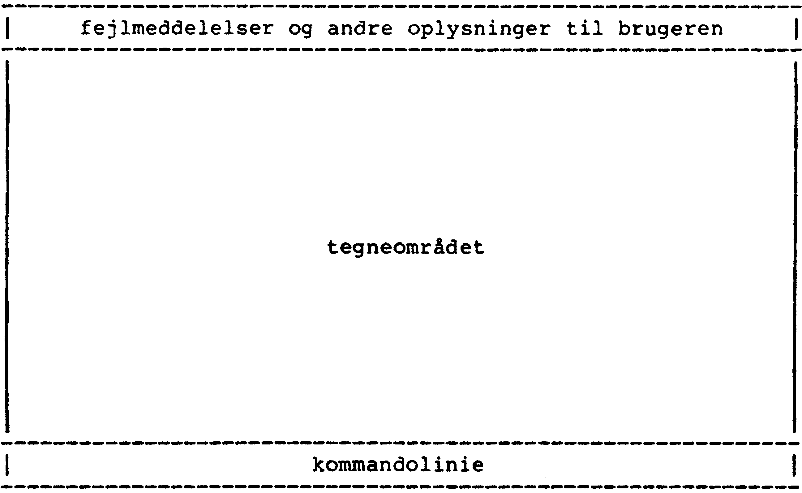  
*Fig. 1. Skærmen er inddelt i 3 felter*

</div>

Den øverste linie anvendes til fejlmeddelelser og andre beskeder og spørgsmål til brugeren. Desuden bruges den, når man overvåger programudførelsen (dvs. udfører een ordre ad gangen, se kapitel 6).

Den nederste linie anvendes som kommandolinie. Den starter med `LOGO>` og når der ikke står andet, er Mikro-Logo klar til at modtage information fra brugeren. Det er her, brugeren giver kommandoer til systemet og sætninger (ordrer) til skildpadden.

Kommandoerne anvendes til at administrere systemet. Det er kun muligt at have een kommando i kommandolinien. Kommandoerne beskrives i kapitel 5.

Eks. på kommandolinie med en kommando:
```logo
LOGO> hjælp
```

---

<!-- Side 4 -->
Sætningerne til skildpadden kan enten være basale systemdefinerede (se kapitel 4) eller brugerdefinerede (se 4.4 og 5.1). Det er muligt at have flere sætninger på samme linie, hvis de adskilles af `;` . Når kommandolinien indeholder skildpaddesætninger, kaldes den også sætningslinien.

Eks. på kommandolinier med sætninger:
```logo
LOGO> skriv 13*13
LOGO> frem 100; venstre 90; frem 100
```

Under indtastning i kommandolinien er det muligt at bruge editeringstasterne:

| Tast | Funktion |
| :--- | :--- |
| **`←`** | flytter markøren en plads til venstre, hvis det er muligt. |
| **`→`** | flytter markøren en plads til højre, hvis det er muligt. |
| **`↖`** | flytter markøren til starten af linien. |
| **`↘`** | flytter markøren til slutningen af linien. |
| **`TEGN IND`** | skubber teksten til højre og indsætter en blank ved markøren. |
| **`SLET TEGN`** | sletter tegnet, hvor markøren står, og trækker teksten til venstre. |
| **`⌫`** | sletter tegnet til venstre for markøren, trækker teksten til venstre og flytter markøren en plads til venstre. |
| **`A1`** | sletter resten af linien fra, hvor markøren står. |
| **`F1`** | fremkalder den forrige kommandolinie, som indeholder skildpaddesætninger, dvs. den forrige sætningslinie. |
| **`↵` (Retur)** | signalerer, at kommandolinien er færdig og skal udføres. (NB: Det er lige meget, hvor markøren står i linien, når der tastes Retur: det er altid hele linien, der udføres). |

---

<!-- Side 5 -->
| Tast | Funktion |
| :--- | :--- |
| **`ESC`** | signalerer, at man fortryder, og kommandolinien slettes. |

<div align="center">

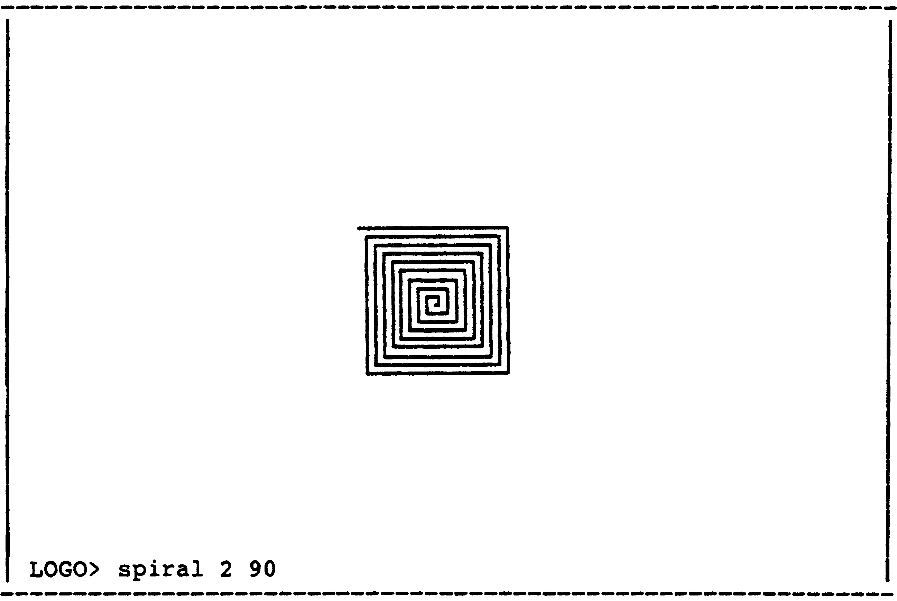  
*Fig. 2. Skærmbillede under udførelse af sætning*

</div>

`spiral` er en brugerdefineret sætning med 2 parametre; den defineres i afsnit 4.4.4. Når udførelsen er fuldført, forsvinder `spiral 2 90` fra kommandolinien, og systemet er klar til en ny kommando eller nye sætninger.

Den resterende del af skærmen (dvs. alt undtagen den øverste og nederste linie) kaldes tegneområdet, men anvendes også til tekst, idet visse kommandoer har brug for at vise flere linier tekst på skærmen. Der er en kommando `tegnigen` (dvs. lav tegningen igen), se 5.3. Denne kommando bruges, hvis man vil have tegningen frem, som er blevet slettet af en kommando, der bruger tegneområdet til tekst.

---

<!-- Side 6 -->
*(Denne side er blank i originalen)*

---

<!-- Side 7 -->
# 4. SÆTNINGER

Til at tegne på skærmen anvendes en fiktiv skildpadde, som hele tiden har en placering og en retning, og som kan bringes til at tegne, når den flyttes. Når der startes, er skildpadden placeret midt på skærmen og pegende til højre, dvs. i position (0,0) og retning 0 grader. Det øverste højre hjørne af tegneområdet på en PICCOLINE skærm har koordinaterne (280,160), og det nederste venstre hjørne har koordinaterne (-280,-160), dvs. det er muligt at adressere fra -280 til 280 i vandret retning og fra -160 til 160 i lodret retning. På en Partner er de tilsvarende tal 360 og 230. Hvis skildpadden flyttes uden for dette område, vil der ikke blive tegnet på skærmen, når skildpadden flyttes, men skildpadden vil alligevel ændre position.

<div align="center">

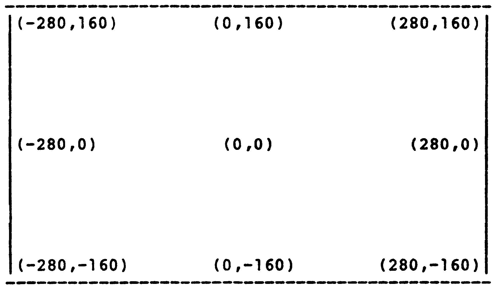  
*Fig. 3. Tegneområdets størrelse på en PICCOLINE*

</div>

Sætningerne kan inddeles i tre slags:
- tegnesætninger
- tildelings-, indlæsnings- og udskrivningssætninger
- kontrolsætninger

Men først følger et afsnit om udtryk og variable, som indgår som argumenter i sætningerne.

Første gang man læser denne manual, er det måske nemmere at forstå, hvis man starter med indledningen til afsnit 4.2 og eksemplerne i afsnit 4.2.5. Og derefter læser hele afsnit 4.2, inden afsnit 4.1 læses. Men da variable og udtryk bruges i afsnit 4.2, er afsnittene for fuldstændighedens skyld placeret i denne rækkefølge.

---

<!-- Side 8 -->
## 4.1 Variable og udtryk

### 4.1.1 Variable

En variabel har et navn og en værdi. Navnet på variablen består af højst 16 bogstaver og cifre, hvor det første skal være et bogstav. Når der refereres til en variabels navn i et udtryk, er det variablens værdi, der skal indgå. Når der refereres til en variabels navn i en tildelingssætning eller indlæsningssætning (se 4.3), betyder det, at variablen skal have en ny værdi. Hvis en variabel refereres i et udtryk, inden den eksplicit har fået en værdi, har den værdien 0.

Eks. på variabelnavne:
```
sidelængde
antal
vinkel2
```

### 4.1.2 Udtryk

Et udtryk er en beregningsforskrift, som kan udregnes til et heltal i intervallet fra -32768 til 32767. Der må ikke være blanke (dvs. "mellemslag") i et udtryk. Der kan indgå følgende operatorer: `+`, `-`, `*`, `/`, `**`, `=`, `<`, `>`, `<=`, `>=` og `<>` i et udtryk.

Operatorerne har følgende betydninger:

| Operator | Betydning |
| :---: | :--- |
| **`+`** | heltalsaddition eller positivt fortegn |
| **`-`** | heltalssubtraktion eller negativt fortegn |
| **`*`** | heltalsmultiplikation |
| **`/`** | heltalsdivision, dvs. en eventuel rest smides væk. Der kommer en fejlmeddelelse, hvis divisoren er 0. |
| **`**`** | potensopløftning. Der kommer en fejlmeddelelse, hvis det andet argument er negativt. |
| **`=`** | lig med |

---

<!-- Side 9 -->
| Operator | Betydning |
| :---: | :--- |
| **`<`** | mindre end |
| **`<=`** | mindre end eller lig med |
| **`>`** | større end |
| **`>=`** | større end eller lig med |
| **`<>`** | forskellig fra |

De kræver alle to operander, bortset fra at `+` og `-` også kan anvendes som fortegn. Som operander kan indgå talkonstanter, variabelnavne, parentesudtryk, funktionsudtryk og andre udtryk.

Eks.:
```
2+3
-2*vinkel
(side+20)*3
```

Talkonstanter består af et antal cifre, som kan opfattes som et heltal. Negative heltal laves som udtryk med `-` som fortegnsoperator.

Eks.:
```
-100
```

Variabelnavne i et udtryk betyder, at variablens værdi skal indgå på dette sted i udtrykket.

Eks.:
```
sidelængde
```

Parentesudtryk er et udtryk omsluttet af parenteser.

Eks.:
```
(2+3)
```

Funktionsudtryk: I øjeblikket er der kun een funktion, `tlf` (en forkortelse for tilfældig). Denne kræver et argument (i parenteser). Dette argument er et udtryk, som skal udregnes til et positivt tal (ellers kommer der en fejlmelding). `tlf` giver et tilfældigt heltal, som er større end eller lig 0 og mindre end argumentet.

Eks.: `tlf(100)` giver et tilfældigt heltal mellem 0 og 99 (begge inclusive).

---

<!-- Side 10 -->
Udtryk kan selvfølgelig også indgå som operander i andre udtryk. Det er derfor nødvendigt at bestemme, i hvilken rækkefølge operatorerne udføres:

1. Først beregnes udtryk i parenteser (på samme måde som beskrives her).
2. Dernæst funktionsudtryk og potensopløftning (`**`) (potensopløftning fra højre mod venstre, hvis der er flere af denne operator).
3. Dernæst operationer med `*` og `/` (fra venstre mod højre, hvis der er flere af disse operatorer).
4. Så `+` og `-` (fra venstre mod højre, hvis der er flere af disse operatorer).
5. Til sidst alle de relationelle operatorer: `=`, `<`, `>`, `<=`, `>=`, og `<>`.

Eks.: `3+4*5/3<-7+tlf(7*længde)+side`

Dette udregnes på følgende måde (markeres ved at sætte ekstra parenteser):

* Venstresiden: `3+((4*5)/3)`
* Højresiden: `((-7)+(tlf(7*længde)))+side`
* og til sidst `<` (mindre end).

Det er kun muligt at have flere relationelle operatorer i et udtryk, hvis der er parenteser, så der ikke er to relationelle operatorer på "samme niveau".

Eks.: `(antal<10)=(side>20)` er tilladt, hvorimod `1<2<3` ikke er tilladt.

Det er kun muligt at have fortegnene `+` og `-` forrest i et udtryk, eller lige efter en relationel operator, eller forrest i et udtryk i parenteser.

Eks.: `2*-antal` er ikke tilladt, det kan i stedet skrives som `-2*antal`

---

<!-- Side 11 -->
Alle relationelle operatorer (`=`, `<`, `<=`, `>`, `>=`, `<>`) giver resultatet 1, hvis relationen gælder mellem de indgående operander (relationen er sand), og 0, hvis relationen ikke gælder (relationen er falsk).

Eks.:
```
9*9=81
20*(tæller<10)
```

Det første udtryk har værdien 1. Det andet udtryk har værdien 20 (hvis `tæller` er mindre end 10) eller værdien 0 (hvis `tæller` ikke er mindre end 10).

Det er muligt at simulere de logiske operatorer AND (logisk og) og OR (logisk eller) ved at bruge gange (`*`) og plus (`+`), da 0 opfattes som falsk og et tal forskellig fra 0 som sandt.

Eks.: `(antal<10)*(side>20)`

Dette udtryk er 1, hvis både `antal` er mindre end 10 og `side` er større end 20.

Eks.: `(antal<10)+(side>20)`

Dette udtryk kan antage værdierne 0, 1 og 2. Hvis begge deludtryk er sande, er værdien 2. Hvis præcis et af deludtrykkene er sandt, er værdien 1. Hvis ingen af deludtrykkene er sande, er værdien 0. Dvs. udtrykket er sandt (forskellig fra 0), når bare et af deludtrykkene er sandt.

**Husk:** Der må ikke være blanke i udtryk.

---

<!-- Side 12 -->
## 4.2 Tegnesætninger

Skildpadden er beskrevet ved tre størrelser: positionen, retningen og pennens type. Dette afsnit er derfor inddelt i underafsnit. De første tre beskriver, hvorledes man ændrer henholdsvis positionen, retningen og pennens type. Derefter følger et afsnit med andre sætninger, der også har indflydelse på skildpadden og tegningen. Til sidst er der et afsnit med eksempler.

### 4.2.1 Position

Der er to forskellige måder at ændre skildpaddens position: relativ og absolut. Relativ ændring vil sige, at ændringen er relativ til, hvor skildpadden står i øjeblikket, og hvilken retning den har. Absolut ændring er uafhængig af den øjeblikkelige placering og retning. I alle tilfælde vil skildpaddens retning ikke blive ændret.

Når positionen ændres, vil pennens type afgøre, om der tegnes, slettes eller ingen af delene.

#### Relativ ændring {#pos-relativ-aendring}

**`frem udtryk`**  
**`fr udtryk`**  
Flytter skildpadden frem, så langt som værdien af udtryk angiver, i skildpaddens retning.  
Eks.:  
```logo
frem 100
fr side/2
```
Hvis værdien af udtryk bliver negativ, svarer sætningen til `tilbage` med det tilsvarende positive tal som argument.

**`tilbage udtryk`**  
**`tb udtryk`**  
Flytter skildpadden værdien af udtryk i den modsatte retning af skildpaddens.  
Eks.:  
```logo
tilbage 50
tb længde*2
```

---

<!-- Side 13 -->
#### Absolut ændring {#pos-absolut-aendring}

**`sætx udtryk`**  
Skildpaddens x-position ændres til værdien af udtryk. Y-positionen og retningen ændres ikke. Dvs. skildpadden flyttes vandret.  
Eks.:  
```logo
sætx -200
```

**`sæty udtryk`**  
Skildpaddens y-position ændres til værdien af udtryk. X-positionen og retningen ændres ikke. Dvs. skildpadden flyttes lodret.  
Eks.:  
```logo
sæty ymax
```

**`sætxy udtryk udtryk`**  
Ændrer både x-positionen og y-positionen af skildpadden til værdierne af de to udtryk. Retningen ændres ikke.  
Eks.:  
```logo
sætxy 200 100
```

Når systemet startes, er skildpaddens position (0,0), dvs. midt på skærmen. Tegneområdet på en PICCOLINE skærm refererer fra -280 til 280 i vandret (x-aksens) retning og fra -160 til 160 i lodret (y-aksens) retning. Tegneområdet på en Partner skærm refererer fra -360 til 360 vandret og fra -230 til 230 lodret.

Skildpadden kan godt flyttes uden for tegneområdet, og den vil stadigvæk udføre de ordrer, den får, men der vil selvfølgelig ikke ske noget på skærmen.

---

<!-- Side 14 -->
### 4.2.2 Retning

Retningen kan også ændres både relativt og absolut. Systemet regner med vinkler i området 0 grader til 360 grader, men brugeren kan selvfølgelig godt bruge vinkler uden for dette område; de bliver bare konverteret til det område, f.eks. bliver både -90 grader og 630 grader konverteret til 270 grader. En retning på 0 grader betyder, at skildpadden peger vandret til højre; 90 grader betyder, at skildpadden peger opad. Når retningen ændres, vil den kun ses på skærmen, hvis skildpadden er vist ved en pil (se kommandoen `pil`, afsnit 5.3).

#### Relativ ændring {#ret-relativ-aendring}

**`venstre udtryk`**  
**`ve udtryk`**  
Skildpaddens retning ændres med værdien af udtryk (til venstre) i forhold til, hvor den peger nu. Hvis værdien af udtryk er negativt, svarer det til at dreje til højre med det tilsvarende positive tal.  
Eks.:  
```logo
venstre 45
ve vinkel1*2
```

**`højre udtryk`**  
**`hø udtryk`**  
Modsat af venstre.  
Eks.: `højre 90` er det samme som `venstre 270` eller `venstre -90`.

#### Absolut ændring {#ret-absolut-aendring}

**`drejtil udtryk`**  
Skildpaddens retning sættes lig værdien af udtryk (uafhængig af retningen før).  
Eks.:  
```logo
drejtil 90
```

Når systemet starter, er retningen 0 grader (vandret til højre).

---

<!-- Side 15 -->
### 4.2.3 Pentype

Pentypen angiver, hvad der sker, når skildpadden flyttes. Skildpadden kan enten tegne, slette eller bare flyttes. Pentypen ændres ved følgende tre sætninger; desuden vil `viskud` og `start` (se 4.2.4) ændre pentypen til at tegne.

**`tegn`**  
Når skildpadden flyttes, vil der blive tegnet en linie fra punktet, der flyttes fra, til punktet, der flyttes til.

**`slet`**  
Når skildpadden flyttes, vil der blive slettet punkter på de linier, der krydses, og hele linier, hvor skildpadden løber oven i en eksisterende linie.

**`løft`**  
Hverken tegner eller sletter. Når skildpadden flyttes, vil der ikke ske noget, bortset fra at skildpaddens position ændres, og det vil kun kunne ses på skærmen, hvis skildpadden er markeret med en pil (se kommandoen `pil`, 5.3).

Når systemet startes, vil pennens type være `tegn`.

### 4.2.4 Andre sætninger til skildpadden

**`hjem`**  
Flytter skildpadden til position (0,0) (dvs. midt på skærmen) og med retning 0 grader. Afhængig af pennens type vil der blive tegnet, slettet eller ske ingenting ved flytningen.  
Eks.: `hjem` er det samme som:
```logo
sætxy 0 0
drejtil 0
```

**`viskud`**  
Sletter tegningen, men ændrer ikke skildpaddens position og retning. Pentypen ændres til `tegn`.

---

<!-- Side 16 -->
**`start`**  
Sletter tegningen og placerer skildpadden midt på skærmen, dvs. i position (0,0), og med retning 0 grader. Pentypen ændres til `tegn`.  
Eks.: `start` kan laves som:
```logo
hjem
viskud
```
Derimod vil:
```logo
viskud
hjem
```
ikke gøre det, da der bliver tegnet en linie fra positionen før til (0,0).

**`hvor variabel variabel variabel`**  
Aflæser skildpaddens position og retning, så de kan indgå i udtryk i de følgende sætninger (se eksempel 2 i afsnit 4.2.5).  
Eks.:  
```logo
hvor x y vinkel
```
Variablen `x` får værdien af skildpaddens x-position, variablen `y` får værdien af skildpaddens y-position, og `vinkel` får værdien af skildpaddens retning.

**`pilind`**  
Sætter en pil til at markere skildpaddens position og retning. Pilen slettes, når skildpadden flyttes eller ændrer retning, eller hvis sætningen `pilud` gives. Hvis man er interesseret i at have en pil hele tiden, skal man bruge kommandoen `pil` (se 5.3).

**`pilud`**  
Sletter en pil sat ved `pilind`, men ikke ved kommandoen `pil` (se denne, 5.3).

---

<!-- Side 17 -->
### 4.2.5 Eksempler med simple tegninger

Det kan være en fordel at bruge relative operatorer til at ændre skildpaddens position og retning, da det derved er muligt at bruge de samme ordrer til at lave den samme tegning et andet sted og i en anden retning. Dette er nemt ved hjælp af procedurer (se 4.4), idet man så giver en samling af ordrer et navn og udfører denne samling af ordrer ved at referere til dette navn.

I de følgende eksempler kan ordrerne skrives over en eller flere sætningslinier. Hvis der skrives flere ordrer på en sætningslinie, skal de adskilles med `;` . For overskuelighedens skyld skrives ordrerne under hinanden med een på hver linie.

#### Eksempel 1

Følgende sætninger vil tegne et kvadrat med sidelængde 100:

```logo
frem 100
venstre 90
frem 100
venstre 90
frem 100
venstre 90
frem 100
```

<div align="center">

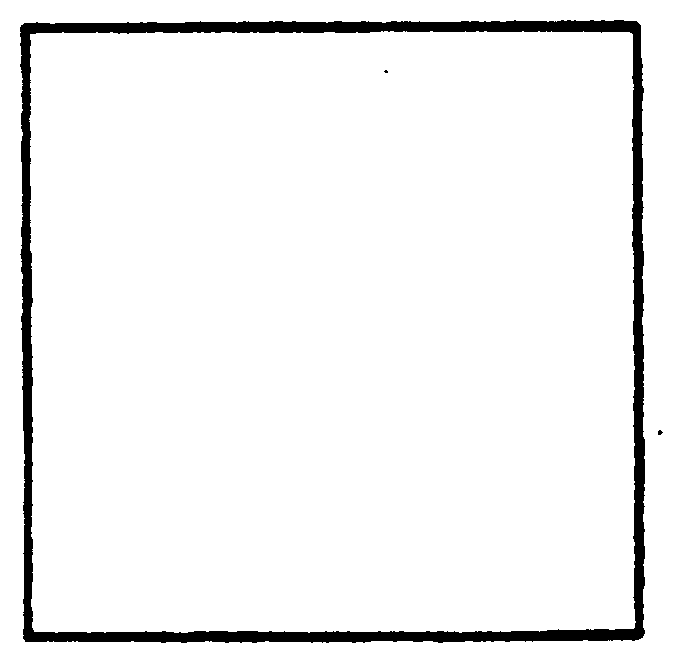  
*Fig. 4. Et kvadrat*

</div>

---

<!-- Side 18 -->
Efter disse ordrer vil skildpaddens retning være nedad, dvs. hvis vi skriver ordren:

```logo
pilind
```

får vi denne tegning på skærmen:

<div align="center">

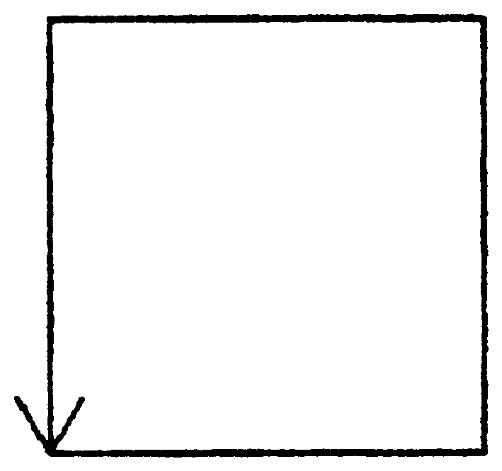  
*Fig. 5. Kvadrat med markeret skildpadde*

</div>

I afsnit 4.4.3 beskrives en anden og kortere måde at lave et kvadrat på.

---

<!-- Side 19 -->
#### Eksempel 2

Et M kan tegnes som:

```logo
venstre 90
frem 100
højre 90+45
frem 70
venstre 90
frem 70
venstre 45
tilbage 100
højre 90
```

<div align="center">

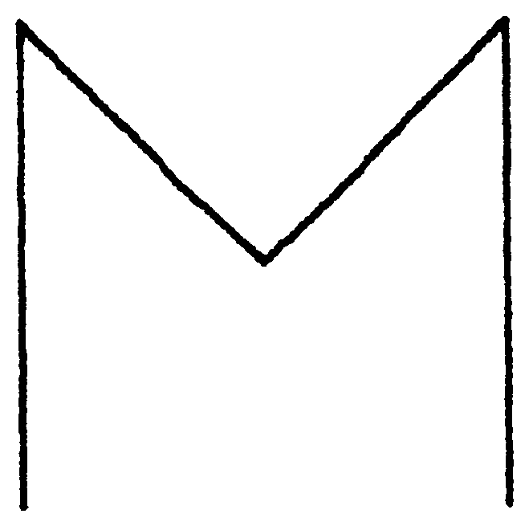  
*Fig. 6. Et M*

</div>

Her vil skildpadden starte nederst i første ben af M og slutte nederst i andet ben. Hvis man ønsker, at skildpadden også skal slutte nederst i første ben, kan det gøres ved at tilføje:

```logo
hvor x y vinkel
```
som den første sætning og

```logo
sætxy x y
```
som den sidste sætning.

---

<!-- Side 20 -->
#### Eksempel 3

Dette eksempel laver et H, hvor højden er 100 og bredden 60, og hvor skildpadden starter og slutter nederst i det første ben pegende henad den linie, H'et kommer til at stå på (denne linie er ikke nødvendigvis vandret; det afhænger af skildpaddens retning, inden de følgende ordrer udføres).

```logo
venstre 90
frem 100
tilbage 50
højre 90
frem 60
venstre 90
frem 50
tilbage 100
højre 90
løft
tilbage 60
```

<div align="center">

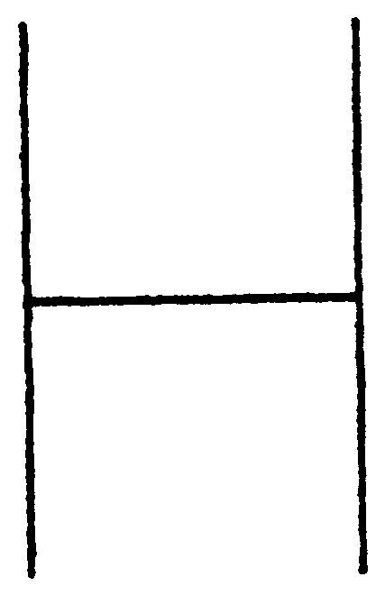  
*Fig. 7. Et H*

</div>

---

<!-- Side 21 -->
Hvis vi efter at have tegnet H finder ud af, at vi kun vil have et lille h, kan vi ændre tegningen (vi forudsætter, at vi ikke har lavet nogle ordrer i mellemtiden; dette betyder bl.a., at pennen er løftet):

```logo
frem 60
venstre 90
frem 50
slet
frem 50
løft
tilbage 100
højre 90
tilbage 60
```

<div align="center">

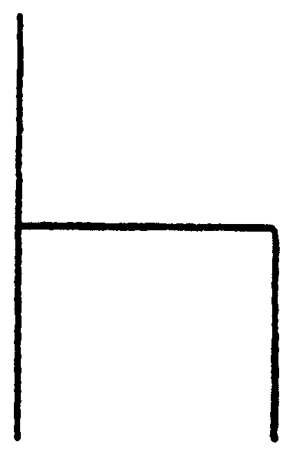  
*Fig. 8. H ændret til h*

</div>

---

<!-- Side 22 -->
## 4.3 Tildelings-, indlæsnings- og udskrivningssætninger

### 4.3.1 Tildelingssætninger

**`variabel := udtryk`**  
**`variabel = udtryk`**  
Betyder, at variablen får en ny værdi, nemlig værdien af udtryk.

Der må ikke være blanke mellem `:` og `=`, men der må, men behøver ikke, være blanke efter variabelnavnet eller inden udtrykket.

Eks.:  
```logo
vinkel = 360/antalsider
tæller := tæller+1
```

I den første tildelingssætning udregnes udtrykket `360/antalsider`, og variablen `vinkel` får denne værdi. I den anden tildelingssætning tælles variablen `tæller` een op.

### 4.3.2 Indlæsningssætninger

**`henttal variabel`**  
Bevirker, at programudførelsen stopper, og navnet på variablen skrives i øverste linie. Udførelsen fortsætter først, når brugeren skriver et tal efterfulgt af et tryk på Retur-tasten.

Eks.:  
```logo
henttal sidelængde
```

**`henttast variabel`**  
Ved udførelsen af denne sætning ventes der, indtil en tast trykkes ned. Variablen får ASCII-værdien (dvs. det tal), der svarer til tasten, der blev trykket ned. En tabel over ASCII-værdierne findes i bilag D.

Eks.:  
```logo
henttast kommando
```
Udførelsen stopper indtil en tast trykkes ned. Hvis `a` trykkes ned, får variablen `kommando` værdien 97; hvis `A` trykkes ned, får `kommando` værdien 65.

---

<!-- Side 23 -->
**`læstast variabel`**  
Variablen tildeles værdien 0, hvis ingen tast har været trykket ned, ellers får variablen ASCII-værdien af den nedtrykkede tast. Det må ikke være mellemrumstasten, Retur eller ESC-tasten, da de bruges i forbindelse med overvågning af udførelsen af sætninger (se kapitel 6). Tegnenes ASCII-værdier findes i bilag D. Bemærk forskellen mellem `henttast` og `læstast`.

Eks.:  
```logo
læstast kommando
```

### 4.3.3 Udlæsningssætninger

**`skriv udtryk`**  
Skriver værdien af udtryk i den øverste linie. Kan bl.a. anvendes som en slags lommeregner fra kommandolinien.

Eks.:  
```logo
skriv længde*højde
```

**`sætning tekst`**  
Den tekst, der kommer efter `sætning`, skrives i skærmens øverste linie. `sætning` kan ikke anvendes fra kommandolinien, men kun i procedurer, se 4.4.4.

Eks.:  
```logo
sætning arealet er
```
Udskriver `arealet er` i den øverste linie på skærmen.

**`udport udtryk udtryk`**  
Skriver det andet udtryks værdi ud på den port, som det første udtryk angiver. Denne ordre kan anvendes til at styre robotter og trafiklys, som er koblet til en af portene bag på en PICCOLINE eller en Partner, men det kræver et nøjere kendskab til en enhed, der er koblet til en port for at vide, hvad der skal sendes ud på porten.

---

<!-- Side 24 -->
## 4.4 Kontrolsætninger

Der er tre måder at lave kontrolsætninger: procedurer, betingelsessætninger og gentagelsessætninger. Herudover beskriver dette afsnit også definition af procedurer.

### 4.4.1 Procedurekald

En procedure er en navngivning af en sekvens af ordrer. Det beskrives i afsnit 4.4.4 og 5.1, hvorledes man laver procedurer. En procedure udføres ved at skrive dens navn i en sætningslinie.

Eks.: Hvis `hus` er navnet på en procedure, der tegner en husgavl, vil sætningslinien, som kun indeholder ordet `hus` lave tegningen nedenfor.

<div align="center">

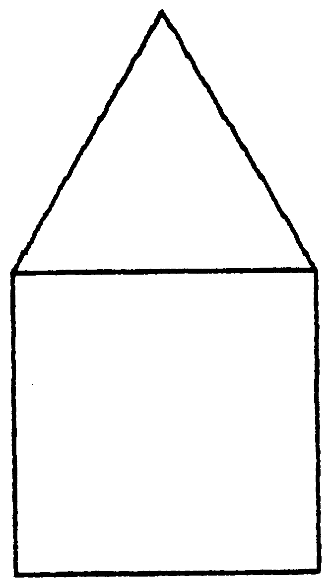  
*Fig. 9. Et hus*

</div>

---

<!-- Side 25 -->
Procedurer kan også have parametre på samme måde som de prædefinerede sætninger, f.eks. har `frem` en parameter og `sætxy` to parametre.

Eks.: Hvis `polygon` er en procedure med to parametre, der angiver sidelængden og antallet af kanter i polygonen, vil de følgende sætningslinier tegne en tikant og en sekskant.

```logo
polygon 50 10
løft
frem 100
tegn
polygon 100 6
```

<div align="center">

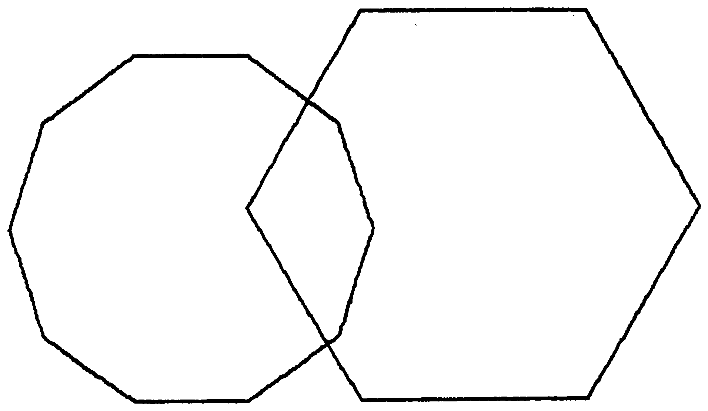  
*Fig. 10. To polygoner*

</div>

Det er nødvendigt, at aktuelle parametre (dvs. parametrene i procedurekaldet) forekommer i samme rækkefølge som de formelle parametre (dvs. parametrene i proceduredefinitionen) (se også 4.4.4).

Eks.: `polygon 10 50` er en 50-kant med sidelængden 10, hvis `polygon` er defineret, så den første formelle parameter er sidelængden og den anden antallet af kanter.

---

<!-- Side 26 -->
### 4.4.2 Betingelsessætninger

Disse kaldes således, da en betingelse styrer, hvilke sætninger der udføres. Der er to udgaver af betingelsessætninger (også kaldet hvis-sætninger):

1)
```logo
hvis udtryk
  sætninger
ellers
  sætninger
sluthvis
```

2)
```logo
hvis udtryk
  sætninger
sluthvis
```

Hvis udtryk er sandt (dvs. forskelligt fra 0), udføres sætningerne lige efter, indtil et eventuelt `ellers` mødes, hvorefter der fortsættes efter `sluthvis`. Hvis udtryk er falsk (dvs. lig 0), udføres sætningerne mellem `ellers` og `sluthvis`; hvis der ikke er noget `ellers`, fortsættes bare efter `sluthvis`.

Der må gerne være mere end een sætning mellem `hvis` og `ellers` og mellem `ellers` og `sluthvis`.

Eks.:  
```logo
hvis antal>2
  polygon 100 antal
ellers
  frem 100
  tilbage 100
sluthvis
```
Hvis `antal` er større end 2 tegnes en polygon med sidelængde 100. Hvis `antal` er mindre end eller lig med 2 tegnes bare en streg af længde 100.

Eks.:  
```logo
hvis x>100
  hjem
  x := 0
sluthvis
```

Bemærk, at når betingelsessætninger skrives i kommandolinien, skal de enkelte dele adskilles med `;` og hele hvis-sætningen skal være på een linie.

Eks.:  
```logo
hvis x>100; hjem; x:=0; sluthvis
```

---

<!-- Side 27 -->
### 4.4.3 Gentagelsessætninger

En gentagelsessætning udfører nogle sætninger et vist antal gange:

```logo
gentag udtryk
  sætninger
hertil
```

Udtrykket udregnes, og hvis det er positivt, udføres sætningerne mellem `gentag` og `hertil` det antal gange, som udtrykket angiver.

Der må gerne være mere end een sætning mellem `gentag` og `hertil`.

Eks.:  
```logo
gentag 4
  frem 100
  venstre 90
hertil
```
Tegner et kvadrat med sidelængde 100 (sammenlign med eksempel 1, afsnit 4.2.5). Bemærk at skildpaddens retning er den samme før og efter udførelsen af sætningerne ovenfor, hvorimod dette ikke er tilfældet i eksempel 1.

Eks.:  
```logo
gentag antalsider
  frem sidelængde
  venstre 360/antalsider
hertil
```
Tegner en polygon.

Her skal også sættes `;` når en gentagelsessætning skrives i sætningslinien, og hele gentagelsessætningen skal være på een linie.

Eks.:  
```logo
gentag antal; fr side; ve 360/antal; hertil
```

---

<!-- Side 28 -->
### 4.4.4 Definition af procedurer {#def-procedurer-kap4}

Når man definerer procedurer, er det ikke muligt at have en tegning på skærmen, da tegneområdet bruges til at indeholde sætningerne i proceduren. Det er kun muligt at definere procedurer ved bestemte kommandoer (se 5.1); det er ikke muligt at gøre det direkte i sætningslinien. Når man har defineret en ny procedure, har man lært skildpadden en ny sætning; en procedure kaldes derfor også en brugerdefineret sætning.

En procedure består af maksimalt 21 linier. Den første linie er procedurehovedet. De andre linier (procedurekroppen) indeholder sætninger; dog skal den sidste indeholde ordet `slut`. Der må ikke stå flere sætninger på en linie (i modsætning til i sætningslinien).

Procedurehovedet består af ordet `begynd` efterfulgt af navnet på proceduren og navne på eventuelle formelle parametre. Der kan højst være 6 parametre. Alle navne skal starte med et bogstav og må efterfølges af op til 15 bogstaver eller cifre.

Eks. på et procedurehoved:
```logo
begynd polygon side antal
```

Parameternavne er lokale til proceduren, dvs. i sætningerne i proceduren kan man referere til parameternavne.

Eks.:  
```logo
begynd polygon side antal
  gentag antal
    frem side
    venstre 360/antal
  hertil
slut
```

Proceduren hedder altså `polygon` og har 2 parametre, hvis formelle navne er `side` og `antal`. Hvis man laver et procedurekald, f.eks. `polygon 20 8`, vil sætningerne for proceduren blive udført, idet `side` har værdien 20 og `antal` værdien 8.

**Bemærk:** Systemet vil lave indrykninger, som bruges til at markere, hvorledes `begynd`-`slut`, `gentag`-`hertil` og `hvis`-`ellers`-`sluthvis` hører sammen. Man skal ikke bekymre sig om indrykninger, når man skriver en procedure ind; de laves automatisk af Mikro-Logo, når proceduren er færdig.

---

<!-- Side 29 -->
En procedure kaldes rekursiv, hvis den i procedurekroppen refererer til sit eget navn.

Eks.:  
```logo
begynd spiral side vinkel
  frem side
  venstre vinkel
  spiral side+2 vinkel
slut
```

Hvis man for eksempel kalder `spiral 2 90`, vil den kalde `spiral 4 90`, som kalder `spiral 6 90` o.s.v. Da hvert kald kræver noget lager, er der en øvre grænse for, hvor mange rekursive kald der kan laves.

<div align="center">

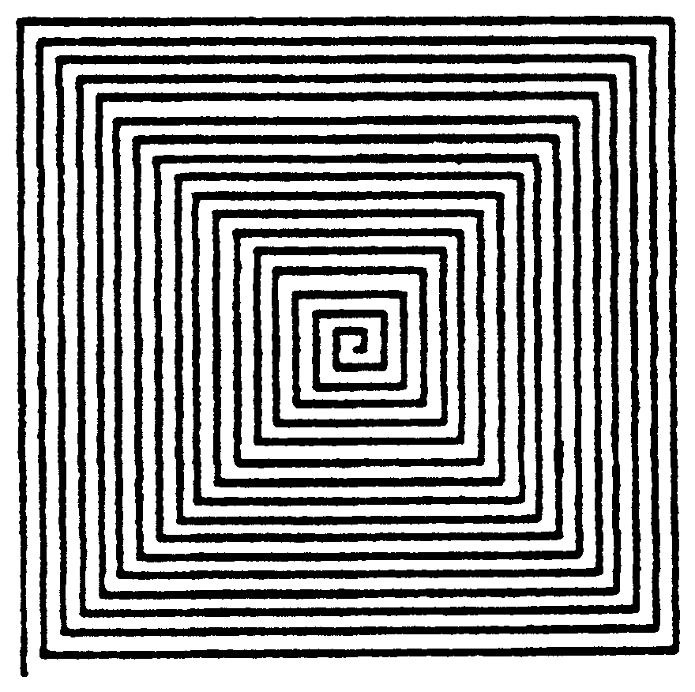  
*Fig. 11. Spiral 2 90*

</div>

---

<!-- Side 30 -->
For at kunne stoppe en rekursion er der endnu en sætning, `stop`, som — hvis den mødes under udførelse af et procedurekald — bevirker, at dette procedurekald afsluttes.

Eks.:  
```logo
begynd spiral side vinkel
  hvis side>100
    stop
  ellers
    frem side
    venstre vinkel
    spiral side+2 vinkel
  sluthvis
slut
```

Hvis man kalder `spiral 2 90`, vil der kun blive lavet 51 kald af `spiral`, da `spiral 102 90` vil opfylde stop-betingelsen.

Hvis et `stop` mødes i sætningslinien, stopper udførelsen af sætningslinien, også selv om der er mere tilbage i sætningslinien.

Der er flere eksempler med procedurer i bilag B.

---

<!-- Side 31 -->
# 5. KOMMANDOER

Kommandoer bruges til administration af systemet. Kommandoerne kan inddeles i 4 grupper:

- kommandoer der administrerer procedurer
- kommandoer der administrerer Logo-filer på disketten
- kommandoer der sørger for tegning på andre medier
- andre kommandoer

Når man afgiver en kommando til systemet, behøver man ikke give alle argumenter; systemet spørger selv efter de manglende argumenter, og det fortæller ovenikøbet, hvad argumentet skal betyde (f.eks. procedurenavn). Det er derfor, at kommandoerne i dette kapitel har forskellige former, svarende til hvor mange argumenter der mangler. Under indtastning af manglende argumenter er det muligt at rette på samme måde som i kommandolinien (se kap. 3); `ESC` betyder så, at man fortryder kommandoen.

Nogle af kommandoerne er indlagt som funktionstaster (F2, F3, ... F12 i den øverste række på tastaturet).

Hvis en kommando er lagt ind i en funktionstast, vil et tryk på funktionstasten bevirke, at den tilsvarende kommando udføres (bortset fra F9, som står for `disk`, se 5.2). Eventuelle argumenter til kommandoen vil mangle og skal indtastes bagefter.

Hvis der som argumenter til en kommando gives navne på procedurer og filer, som ikke eksisterer, og hvor kommandoen forventer, at de skal eksistere, kommer der en fejlmeddelelse (Fejlmeddelelserne er beskrevet i bilag E).

Nogle af kommandoerne (`plist`, `pdisk`, `kopi`, `phjælp`) kræver, at der er en tilsluttet skriver (printer), så første gang en af disse anvendes, bliver brugeren spurgt om, hvor skriveren sidder på. Der er tre muligheder (0, 1 og 2), hvis datamaten ikke er tilsluttet lokalnet:

* `0`: skriver-udgangen på centralenheden (CPU'en),
* `1`: V24-udgangen på CPU'en (ikke standardudstyr) og
* `2`: skriver-udgangen på disketteenheden.

Hvis datamaten er tilsluttet lokalnet, er der 16 muligheder (tallene 0 til 15), og navngivningen af skrivere afgør, hvorledes de hænger sammen med de eksisterende.

Hvis der svares med RETUR, vælges den aktuelle skriver, der var, da Mikro-Logo startede op. Kommandoen `kopi` kræver en RC603 skriver eller en tilsvarende skriver, der kan tegne grafik.

---

<!-- Side 32 -->
## 5.1 Procedurekommandoer

Der findes både kommandoer til at oprette og ændre indholdet af procedurer, og kommandoer der kun giver information om de definerede procedurer.

### 5.1.1 Definition af procedurer {#def-procedurer-kap5}

Der er to måder at lave en procedure: Enten skriver man sætningerne, som proceduren skal bestå af (v.hj.a. en editor, dvs. et retteprogram), eller også laver man den ud fra en tegning. Sidst i dette afsnit er der en oversigt over kommandoerne, der gør dette, men først en mere uddybende beskrivelse af, hvordan det gøres.

Når man laver en procedure v.hj.a. editoren, er der to måder at starte på: Enten kan man starte helt fra bunden, eller også kan man ændre en allerede eksisterende procedure. Kommandoen `lær` (funktionstast F5) laver en blank side, hvor der kun står `begynd` i øverste linie, dvs. man kan indtaste en procedure. Kommandoen `ret` (F6) beder om et procedurenavn, og teksten for denne procedure kommer så op på skærmen, og det er muligt at rette i både programhovedet og programkroppen. Hvis man laver en procedure med samme navn som en allerede eksisterende, bliver den gamle slettet.

Under editering har følgende taster speciel betydning:

| Tast | Funktion |
| :--- | :--- |
| **`←`** | flytter markøren en plads til venstre, undtagen hvis markøren står over det første tegn på en linie, så flytter den til det sidste tegn på linien over (hvis det ikke er i den øverste linie, for så flyttes markøren ikke). |
| **`→`** | flytter markøren en plads til højre, undtagen hvis markøren står over det sidste tegn på en linie, så flyttes til det første tegn på næste linie (hvis det ikke er i den sidste linie). |
| **`↑`** | flytter markøren en linie op, hvis det er muligt. |
| **`↓`** | flytter markøren en linie ned, hvis det er muligt. |

---

<!-- Side 33 -->
| Tast | Funktion |
| :--- | :--- |
| **`↵` (Retur)** | flytter markøren ned først på næste linie, undtagen hvis markøren er i sidste linie, hvor det virker ligesom A4-tasten (editering er færdig og accepteres). |
| **`TEGN IND`** | skubber teksten til højre for markøren til højre og indsætter en blank ved markøren. |
| **`SLET TEGN`** | sletter tegnet, hvor markøren står, og trækker teksten til venstre. |
| **`⌫`** | sletter tegnet til venstre for markøren og trækker teksten sammen. |
| **`A1`** | sletter resten af linien fra, hvor markøren står. |
| **`A2`** | sletter en linie og rykker de efterfølgende linier op. |
| **`A3`** | skubber linierne under markøren ned og indsætter en blank linie. |
| **`A4`** | signalerer, at editeringen er færdig, og proceduren skal gemmes og oversættes. Editoren sætter selv `slut`, hvis det mangler, og procedurekroppen ikke er på mere end 19 linier. Hvis der ikke er plads til `slut`, kan editoren ikke forlades med A4. |
| **`ESC`** | signalerer, at man fortryder editeringen, og teksten ikke skal gemmes. |

Hvis der er fejl i oversættelsen efter A4 (f.eks. manglende argument til sætningen `frem`) kommer der en fejlmeddelelse i den øverste linie (disse fejlmeddelelser er beskrevet i bilag E.2.1). Desuden vender systemet tilbage til kommandolinien, hvor brugeren kan afgive kommandoer og sætninger, men det er ikke muligt at udføre nogle procedurer, før fejlen er rettet.

---

<!-- Side 34 -->
<div align="center">

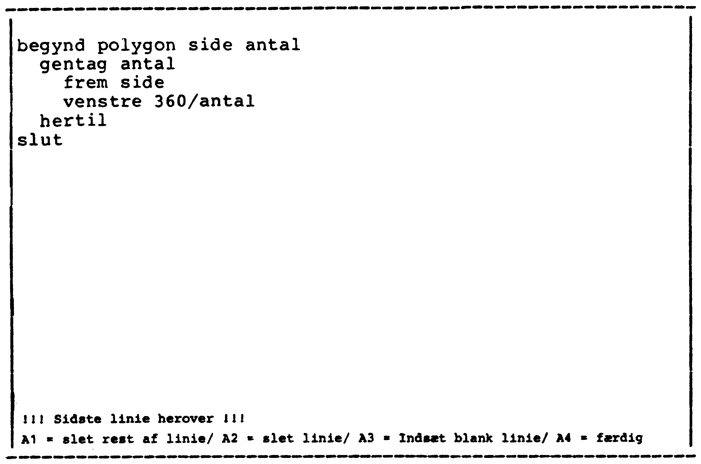  
*Fig. 12. Skærmbillede når en procedure rettes*

</div>

Den anden måde at lave procedurer på er at lave en tegning ved at skrive sætninger i kommandolinien og så udføre dem. Når tegningen er færdig, bruger man kommandoen `lav`, som så beder om et procedurenavn og laver en procedure uden parametre med dette navn og de brugte sætninger som krop. Da en procedurekrop kun må indeholde 19 sætningslinier, og da `glem alle` (se 5.1.2), `start` og `viskud` betyder, at skærmen viskes ren, er det sætningerne siden det sidste `glem alle`, `start` eller `viskud` i kommandolinien, der bliver sat ind i procedurekroppen.

Hvis man forsøger at lave en procedure ved `lav` kommandoen, og denne procedure viser sig at være for lang, får man mulighed for at rette i proceduren, hvor kroppen er de første 19 sætninger eller de sidste 19 sætninger. Så hvis man vil bruge `lav`, skal man være omhyggelig, da det kun er muligt at "få fat i" alle ordrer, hvis der er færre end 38.

---

<!-- Side 35 -->
Ved at bruge `fortryd` kommandoen (se 5.3) er det muligt at fortryde den sidst udførte sætningslinie, og derved er `lav` kommandoen god til at lave en foreløbig version af en procedure, som så kan rettes til med kommandoen `ret`, som beskrevet tidligere i dette afsnit.

Her følger en oversigt over kommandoerne, som er beskrevet i dette afsnit. De er beskrevet på samme form, som de øvrige kommandoer beskrives.

**`lær`**  
**`F5`**  
Bruges til at oprette en ny procedure. Kommandoen er først færdig, når A4 eller ESC trykkes ned.

**`ret pnavn`**  
**`ret`**  
**`F6`**  
Bruges til at rette en eksisterende procedure. Da procedurehovedet også kan editeres, kan kommandoen også bruges til at lave en ny procedure. A4 eller ESC afslutter kommandoen.

**`lav pnavn`**  
**`lav`**  
Laver en ny procedure ud fra de ordrer, der er brugt siden sidste `glem alle` (se 5.1.2), `start` eller `viskud`. Hvis der er brugt flere end 19, er der mulighed for at editere proceduren med de første 19 linier eller med de sidste 19 linier.

I alle tilfælde gælder, at hvis der laves en procedure, som har samme navn som en allerede eksisterende, vil den eksisterende blive slettet, når editeringen accepteres med A4-tasten eller oprettes med `lav` kommandoen.

---

<!-- Side 36 -->
### 5.1.2 Administration af procedurer

I forrige afsnit beskrev vi, hvorledes man kan definere og ændre procedurer. I dette afsnit beskrives, hvorledes vi bestyrer procedurerne.

**`glem pnavn`**  
**`glem`**  
**`F4`**  
Sletter proceduren med navnet `pnavn`. Hvis `pnavn` er lig `alle`, slettes alle procedurer og variable, og tegningen viskes ud (som ved sætningen `start`). Hvis der ikke er en procedure `pnavn`, fås en fejlmeddelelse.

**`hvilke`**  
**`F3`**  
Giver en liste over de definerede procedurer og disses formelle parametre. `hvilke` kan stoppes på samme måde som `list` (se nedenfor), men der er kun behov for det, hvis der er over 21 procedurer.  
Eks.:  
```logo
begynd polygon side antal
begynd trekant side
begynd firkant side
begynd cirkel radius
```

**`list pnavn`**  
**`list`**  
**`F2`**  
Udskriver sætningerne for proceduren `pnavn` på skærmen. Hvis `pnavn` er lig `alle`, udskrives alle procedurer med en blank linie mellem hver procedure. Hvis der ikke er en procedure `pnavn`, fås en fejlmeddelelse.

Da udskriften kan fylde mere end et skærmbillede (hvis `pnavn` er `alle`), er det muligt at stoppe den ved et tryk på mellemrumstasten. Yderligere tryk på mellemrum vil bevirke, at der kommer en linie ad gangen. Tryk på en anden tast fortsætter udskriften. Udskriften kan stoppes helt ved tryk på ESC-tasten.

**`plist pnavn`**  
**`plist`**  
Udskriver på skriveren i stedet for på skærmen, men fungerer ellers som `list`, bortset fra, at udskriften ikke kan afbrydes eller stoppes.

---

<!-- Side 37 -->
## 5.2 Diskettekommandoer

Når man afslutter Mikro-Logo (kommandoen `farvel`, afsnit 5.4), mister man alle de procedurer, man har lavet. Det er derfor gjort muligt at gemme sine procedurer på diskette-filer, således at man kan få fat i procedurerne, når man senere igen anvender Mikro-Logo.

En fil er et område på en diskette. En fil med Logo-procedurer refereres ved dens navn, som består af højst 8 tegn, hvor det første er et bogstav, og de øvrige er bogstaver eller cifre. Bogstaver i filnavne må ikke være æ, ø eller å (dette skyldes, at styresystemet er amerikansk); dette er i modsætning til variabel-, procedure- og parameternavne, som gerne må indeholde æ, ø og å. Foran selve filnavnet kan det specificeres, på hvilken diskettestation filen skal gemmes på eller findes på. Diskettestationen specificeres med et bogstav og adskilles fra selve filnavnet med et `:`. Den første diskettestation i en disketteenhed hedder `a` og en eventuel anden `b`. Hvis diskettestationen ikke specificeres, er det den aktuelle disk, dvs. den, hvorfra Mikro-Logo blev startet op (se brugervejledning for den respektive maskine).

Eks. på filnavne:
```
polygon
b:blomster
a:umulig
```

**`disk`**  
**`F9`**  
Skriver navnene på de filer med Logo-procedurer, der er på den aktuelle disk. Udover navnene skrives også størrelsen af filerne (i bytes).

**Bemærk:** F9 bevirker ikke, at `disk` udføres. Først efter et tryk på Retur udføres kommandoen `disk`, da F9/`disk` også kan anvendes på andre diskettestationer end den aktuelle (se nedenfor).

Eks.: Kommandoen `disk` vil give følgende udskrift, hvis den bruges på en kopi af distributionsdisketten:
```
kasse    6528 b
polygon  2176 b
spiral   1664 b
stjerne  1152 b
```

---

<!-- Side 38 -->
**`disk bogstav`**  
**`F9`**  
Som ovenfor bortset fra, at det er på den diskette, der er i den diskettestation, som bogstav angiver.  
Eks.: `disk b`

**`pdisk`**  
**`pdisk bogstav`**  
Som ovenfor bortset fra, at udskriften kommer på skriver i stedet for på skærmen.

**`gem pnavn filnavn`**  
**`gem pnavn`**  
**`gem`**  
**`F11`**  
Hvis `pnavn` er `alle`, bliver alle procedurer gemt på filen `filnavn`, ellers bliver proceduren `pnavn` gemt på filen `filnavn`. Hvis filen `filnavn` eksisterer i forvejen, bliver brugeren bedt om at bekræfte, at den skal slettes.

**`tilføj pnavn filnavn`**  
**`tilføj pnavn`**  
**`tilføj`**  
**`F12`**  
Proceduren `pnavn` (alle procedurer, hvis `pnavn` er `alle`) bliver tilføjet til filen `filnavn`. Hvis filen `filnavn` ikke eksisterer, kommer der en fejlmeddelelse.

**`hent filnavn`**  
**`hent`**  
**`F10`**  
Indlæser de procedurer, der er på filen `filnavn`. Hvis der i forvejen er procedurer, som har samme navne som nogle af de indlæste, bliver de første slettet.

---

<!-- Side 39 -->
**`fjern filnavn`**  
**`fjern`**  
Sletter en fil med Logo-procedurer på disketten. Hvis filen ikke eksisterer, kommer der en fejlmeddelelse.

## 5.3 Tegning på andre medier

**`kopi`**  
**`F7`**  
Laver en kopi af tegningen på skriveren. Det er nødvendigt, at der er en GSX grafik-driver til skriveren, som der f.eks. er til RC603.

**`tegnigen`**  
Tegner tegningen på skærmen igen. Denne kommando er specielt anvendelig, hvis man ønsker at fortsætte på en tegning, der er blevet slettet ved en af de kommandoer, der bruger hele skærmen til tekst.

Både `kopi` og `tegnigen` tegner fra sidste gang, man anvendte `glem alle`, `start` eller `viskud` i kommandolinien. Hvis man anvender flere sætninger siden sidste `glem alle`, `start` eller `viskud`, end der er plads til, bliver man advaret.

**`holger`**  
Holger er en gulv-skildpadde; i øjeblikket kan følgende tre styres fra Mikro-Logo: Jessop Micro-Electronics, Valiant og Tegnebilen fra Mikro-Værkstedet i Odense. Når Holger kobles til, vil den udføre de ordrer, man skriver i sætningslinien, hvorved det er muligt at lave den samme tegning på gulvet og på skærmen.

---

<!-- Side 40 -->
<div align="center">

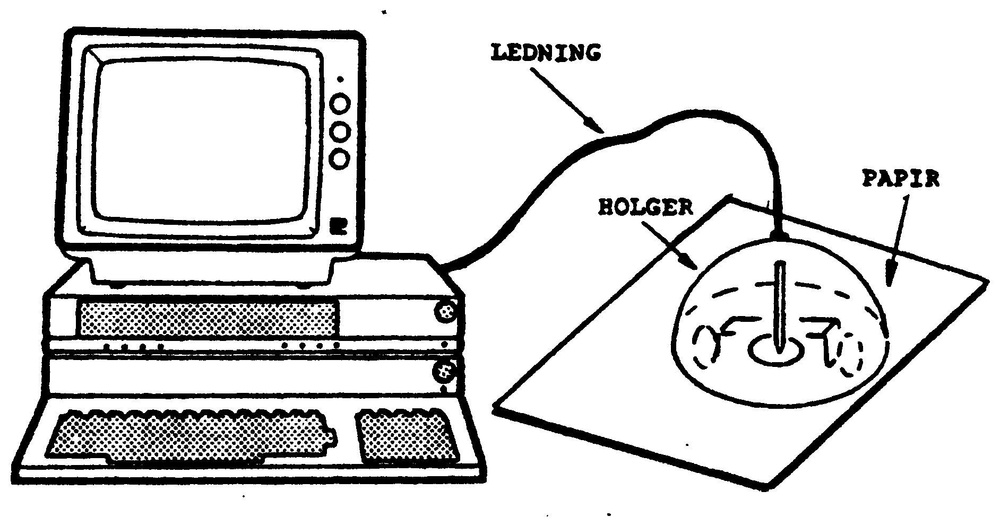  
*Fig. 13. En gulv-skildpadde*

</div>

Holger kobles til og fra ved kommandoen `holger`; hvis Holger er koblet til, vil den blive koblet fra, når kommandoen `holger` gives, og omvendt.

Når Holger kobles til, bliver brugeren spurgt, om Holger er sat til skriverudgangen på centralenheden (CPU'en) eller skriverudgangen på disketteenheden. Det er ikke muligt at styre en Holger over nettet, da det kræves, at man har fuldstændig kontrol over den hele tiden. Herudover spørges der efter en datafil for skildpadden. Denne datafil indeholder forskellige oplysninger om skildpadden. På distributionsdisketten findes følgende datafiler:

* **`jessop`** beskriver skildpadden fra Jessop Micro-Electronics
* **`valiant`** beskriver skildpadden fra Valiant
* **`bil`** beskriver tegnebilen fra Mikro-Værkstedet i Odense

Det er ikke muligt at bruge Holger samtidigt med plotteren.

**`plotter`**  
Kobler en plotter til og fra (på samme måde som ved `holger`).

Når plotteren kobles til, bliver brugeren spurgt om hvilken skriver, plotteren er placeret som (se også bemærkningerne om skrivere i det indledende afsnit i dette kapitel). Herudover spørges der efter en datafil for plotteren. Denne datafil indeholder forskellige oplysninger om plotteren. På distributionsdisketten findes følgende datafiler:

---

<!-- Side 41 -->
* **`rc621`** beskriver plotteren som Regnecentralen leverer
* **`roland`** beskriver Roland-plottere og Digi-Plot
* **`plotter`** indeholder en skabelon for indholdet på en datafil

Det er ikke muligt at bruge plotteren samtidigt med `holger`.

**`Ctrl-P`**  
*(dvs. Ctrl-tasten holdes nede, og der tastes P)*  
Sætter pennen på plotteren ned i venstre hjørne (bruges for at undgå, at blækket løber ud på tegningen, og for at slukke alarm-lampen på plotteren, hvis plotterpennen er kommet udenfor plotterens tegneområde). Når plotteren kobles fra, sættes plotterpennen også ned i venstre hjørne.

## 5.4 Andre kommandoer

**`farvel`**  
Afslutter Mikro-Logo. Inden man afslutter, bør man gemme de procedurer, man ønsker at bruge ved en senere lejlighed (se afsnit 5.2).

**`pil`**  
Bruges til at skifte, om skildpaddens position og retning skal angives med en lille pil. Dette er meget anvendeligt for begyndere, idet det kan være vanskeligt at holde styr på specielt retningen af skildpadden.

Kommandoen `pil` er (ligesom kommandoerne `holger` og `plotter`) en skifter, så hvis kommandoen `pil` gives, vil pilen blive vist, hvis den ikke var vist før, og omvendt.

**`status`**  
Skriver skildpaddens position, retning og pentype i øverste linie af skærmen.

---

<!-- Side 42 -->
**`fortryd`**  
**`F8`**  
Fortryder den sidst udførte sætningslinie, dvs. de streger, der blev tegnet, bliver slettet, og de streger, der blev slettet, bliver gentegnet. Men da systemet ikke kan huske, hvis man har tegnet streger oven i hinanden, kan der ske uønskede ting, hvis man fortryder en linie, der er tegnet oven i en anden. Hvis man fortryder en sætningslinie med `start` eller `viskud`, får man en fejlmeddelelse.

**`hjælp`**  
Giver information om Mikro-Logo, bl.a. en oversigt og en kort beskrivelse af sætninger og kommandoer.

**`phjælp`**  
Skriver oversigten og beskrivelsen af sætninger og kommandoer på skriveren.

**`R`**  
**`Ctrl-F`**  
*(dvs. Ctrl-tasten holdes nede, og der tastes F)*  
Skifter mellem, at tegningen viskes ud inden en ny sætningslinie, og der tegnes videre på tegningen, når der gives en ny sætningslinie. Når Mikro-Logo starter, vil det sidste være tilfældet, dvs. tegningen slettes ikke, når en ny sætningslinie udføres.

**`lager`**  
Anvendes til aftestning af Mikro-Logo.

---

<!-- Side 43 -->
# 6. OVERVÅGNING AF UDFØRELSE AF SÆTNINGER

Når en sætningslinie udføres, kan det være svært at overskue, hvorledes tegningen bliver til, specielt hvis der er mange procedurekald. Derfor er det gjort muligt at afbryde udførelsen og få udført en sætning ad gangen. Dette gøres efter samme princip som ved `list` (afsnit 5.1).

Når der tastes mellemrum, afbrydes udførelsen midlertidigt, og sætningen, der udføres, skrives i den øverste linie sammen med de aktuelle argumenter. Herefter vil der for hver gang der tastes mellemrum, blive udført en linie, og denne vil blive vist i øverste linie, indtil der trykkes på ESC eller Retur. Hvis det er ESC, stoppes udførelsen; hvis det er Retur, fortsættes på normal vis. Hvis der tastes ESC uden forudgående mellemrum, stoppes udførelsen også.

Eks.: Hvis proceduren `spiral 2 90` fra afsnit 4.4.4 udføres med en sætning ad gangen, vil den øverste linie vise følgende (en linie ad gangen, hver gang der tastes mellemrum):

```logo
spiral 2 90
frem 2
venstre 90
spiral 4 90
frem 4
venstre 90
spiral 6 90
frem 6
venstre 90
spiral 8 90
o.s.v.
```

---

<!-- Side 44 -->
*(Denne side er blank i originalen)*

---

<!-- Side 45 -->
# BILAG A. FORSKELLE TIL MIKRO-LOGO PÅ PICCOLO

## A.1 Sætninger

Der er fire sætninger, der har fået nyt navn, og der er tilføjet en ny sætning.

| PICCOLO | PICCOLINE / Partner | KOMMENTAR |
| :--- | :--- | :--- |
| `til` | `begynd` | navnet er ændret for at gøre det mere sigende. |
| `sluttil` | `slut` | navnet er ændret for at gøre det mere sigende. |
| `pil` | `pilind` | navnet er ændret for at undgå konflikt med den nye kommando `pil`. |
| `hent` | `henttal` | navnet er ændret for at undgå konflikt med kommandoen `hent`. |
| | `start` | sætningen er indført, da man ofte er interesseret i både `hjem` og `viskud` (se 4.2.4). |

---

<!-- Side 46 -->
## A.2 Kommandoer

Der er følgende ændringer ved kommandoerne:

| PICCOLO | PICCOLINE / Partner | KOMMENTAR |
| :--- | :--- | :--- |
| `slet` | `glem` | navnet er ændret for at undgå konflikt med sætningen `slet` og forveksling med kommandoen `fjern`. |
| `Ctrl-G` | `F1` / `↖` | tasten er ændret for at gøre det lettere at fremkalde sidste sætningslinie (se kapitel 3). |
| `Ctrl-F` | `R` / `Ctrl-F` | det er gjort nemmere at skifte mellem sammensat tegning og enkelt tegninger (se 5.4). |
| `Ctrl-T` | | er fjernet, da det ikke er muligt at skifte mellem tekstskærm og grafikskærm. |
| `dato` | | er fjernet, da datoen ikke kan ændres. |

---

<!-- Side 47 -->
| PICCOLO | PICCOLINE / Partner | KOMMENTAR |
| :--- | :--- | :--- |
| `Ctrl-C` | | er fjernet, da der ikke er overlay-filer. |
| | `tilføj` | er tilføjet, se 5.2. |
| | `lav` | er tilføjet, se 5.1.2. |
| | `fortryd` | er tilføjet, se 5.4. |
| | `tegnigen` | er tilføjet, se 5.3. |
| | `holger` | er tilføjet, se 5.3. |
| | `pil` | er tilføjet, se 5.4. |
| | `status` | er tilføjet, se 5.4. |
| | `phjælp` | er tilføjet, se 5.4. |

---

<!-- Side 48 -->
# BILAG B. DISTRIBUTIONSDISKETTEN

Inden man starter med at bruge Mikro-Logo, skal man tage en arbejdskopi af distributionsdisketten med Mikro-Logo, og så bruge denne, hver gang man skal lave en diskette med Mikro-Logo. Man bør aldrig anvende distributionsdisketten i det daglige arbejde.

Mikro-Logo installeres på en systemdiskette ved at placere denne i diskettestation A og en kopi af distributionsdisketten med Mikro-Logo i diskettestation B. Den aktuelle disk sættes til A, og følgende kommando gives til CCP/M:

```
submit b:instlogo
```

Denne kommando sørger for at kopiere filerne over på systemdisketten i diskettestation A.

Ud over filerne med Mikro-Logo systemet (`LOGO.CMD`, `LOGOKOM.HLP` og `LOGOSAET.HLP`) indeholder distributionsdisketten et konverteringsprogram, nogle datafiler til skildpadder og plottere, og nogle filer med eksempler på Logo-procedurer. Konverteringsprogrammet (`LOGOCONV.CMD`) konverterer en fil med Logo-procedurer, hvor der er brugt `til` og `sluttil`, til en fil med procedurer med `begynd` og `slut`.

Der er følgende datafiler:

* **`JESSOP.PAD`**: datafil til skildpadden fra Jessop Micro-Electronics
* **`VALIANT.PAD`**: datafil til skildpadden fra Valiant
* **`BIL.PAD`**: datafil til tegnebilen fra Mikro-Værkstedet i Odense
* **`RC621.PLO`**: datafil til RC621-plotteren
* **`ROLAND.PLO`**: datafil til plottere fra Roland
* **`PLOTTER.PLO`**: skabelon for datafil til en plotter

Der er følgende eksempler på filerne med Logo-procedurer:

- polygoner og cirkler
- stjerner
- spiraler
- "umulig" tegning med kasser

Ved at bruge kommandoen `hent` (afsnit 5.2) kan man hente de Logo-procedurer, der er på disse filer, ind i Mikro-Logo.

De følgende afsnit beskriver procedurerne på de 4 filer og er alle opbygget på samme måde. Først beskrives, hvad procedurerne gør. Så er der en tegning lavet ved hjælp af disse procedurer, og til sidst er der en udskrift af procedurerne.

---

<!-- Side 49 -->
## B.1 Polygon

Filen `polygon` indeholder 4 procedurer (her er angivet procedurernes navne og deres formelle parametre):

- `polygon side antal`
- `trekant side`
- `firkant side`
- `cirkel radius`

Proceduren `polygon` er allerede defineret i afsnit 4.4.4. Procedurerne `trekant` og `firkant` er defineret ved `polygon`, hvor antal er henholdsvis 3 og 4.

Procedure `cirkel` tegner en cirkel med centrum det sted, skildpadden står, og med den angivne radius. Først flyttes skildpadden ud på cirkelperiferien, derefter tegnes en 36 siders polygon, og til sidst flyttes skildpadden tilbage til centrum. Det er faktisk ikke muligt at se, at cirklen er en polygon. Det eneste uheldige ved denne procedure er, at det er svært at beregne sidelængden af polygonen nøjagtig nok, da Mikro-Logo kun arbejder med heltal. Sidelængden kan beregnes ud fra, at polygonen og cirklen skal have samme omkreds.

<div align="center">

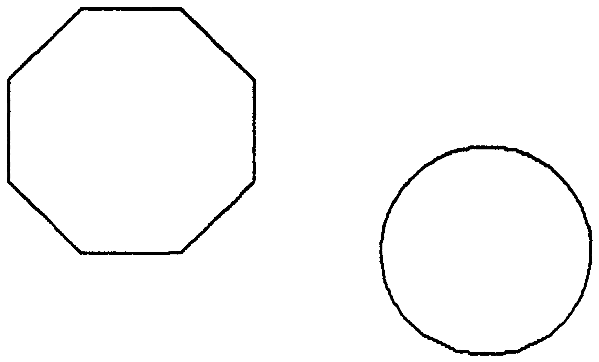  
*Fig. 14. Polygon og cirkel*

</div>

---

<!-- Side 50 -->
Ovenstående figur er lavet med følgende sætninger:

```logo
start
løft
tilbage 100
tegn
polygon 50 8
løft
frem 200
cirkel 50
```

De 4 procedurer består af følgende sætninger:

```logo
begynd polygon side antalkanter
  gentag antalkanter
    frem side
    venstre 360/antalkanter
  hertil
slut

begynd trekant side
  polygon side 3
slut

begynd firkant side
  polygon side 4
slut

begynd cirkel radius
  løft
  frem radius
  venstre 90
  længde := radius*2*22/7/36+1
  tilbage længde/2
  tegn
  polygon længde 36
  løft
  frem længde/2
  højre 90
  tilbage radius
  tegn
slut
```

---

<!-- Side 51 -->
## B.2 Stjerne

Filen `stjerne` indeholder kun een procedure:

- `stjerne side antal`

som tegner en stjerne, hvis `antal` er ulige. Hvis `antal` er lige, kommer der en fejlmeddelelse.

<div align="center">

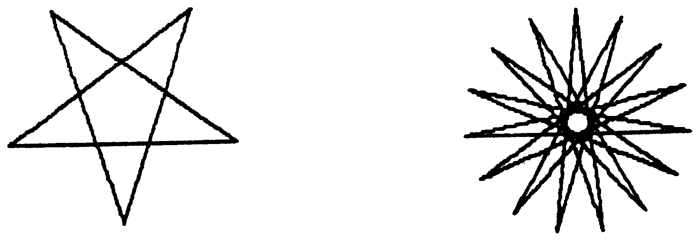  
*Fig. 15. Stjerner*

</div>

Ovenstående figur er lavet med følgende sætninger:

```logo
start
løft
tilbage 100
stjerne 100 5
frem 200
stjerne 100 15
```

---

<!-- Side 52 -->
Procedure `stjerne` er lavet således (Bemærk: `antal=antal/2*2` tester, om antal er lige, da der bruges heltalsdivision):

```logo
begynd stjerne side antal
  hvis antal=antal/2*2
    sætning antal skal være ulige
  ellers
    vinkel := antal/2*360/antal
    tegn
    gentag antal
      frem side
      venstre vinkel
    hertil
    løft
  sluthvis
slut
```

## B.3 Spiral

Filen `spiral` indeholder 3 procedurer:

- `spiral side vinkel`
- `itspiral side vinkel`
- `tlfspiral`

Proceduren `spiral` er allerede defineret i afsnit 4.4.4. Proceduren `itspiral` gør det samme som `spiral`, men er lavet med en gentag-sætning og kaldes derfor en iterativ procedure, hvorimod `spiral` er en rekursiv procedure (den kalder sig selv). Procedure `tlfspiral` laver en spiral, hvor `vinkel` er et tilfældigt tal mellem 90 og 179.

---

<!-- Side 53 -->
<div align="center">

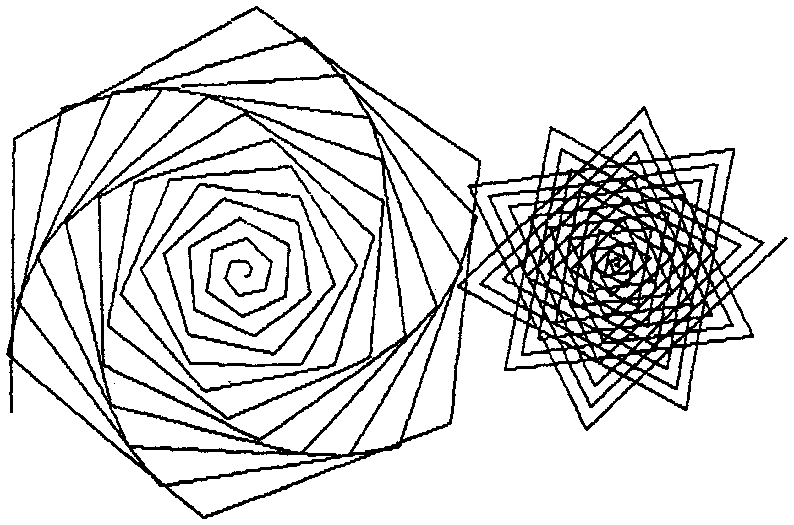  
*Fig. 16. Spiraler*

</div>

Figuren er lavet med følgende sætninger:

```logo
start
løft
sætxy -100 0
tegn
spiral 2 62
løft
sætxy 100 0
tegn
tlfspiral
```

Procedurerne består af følgende sætninger:

```logo
begynd spiral side vinkel
  hvis side>150
    stop
  ellers
    frem side
    venstre vinkel
    spiral side+2 vinkel
  sluthvis
slut
```

---

<!-- Side 54 -->
```logo
begynd itspiral side vinkel
  gentag 100
    frem side
    venstre vinkel
    side := side+2
  hertil
slut

begynd tlfspiral
  i := tlf(90)+90
  spiral 2 i
slut
```

## B.4 Kasse

Filen `kasse` indeholder 5 procedurer:

- `ethjørne side`
- `kryds side`
- `tohjørner side`
- `halvkryds side`
- `startop side antal`

De 4 første er hjælpeprocedurer til proceduren `startop`. Proceduren `ethjørne` tegner en kasse, hvor det ene hjørne mangler; `ethjørne` kalder proceduren `kryds`, som tegner de tre "indvendige" streger. Proceduren `tohjørner` tegner en kasse, hvor to nabohjørner mangler; `tohjørner` kalder proceduren `halvkryds`.

Proceduren `startop` laver en "trekant", hvor siderne består af kasser, og hvor der er "problemer" med perspektivet. Parameteren `antal` angiver, hvor mange kasser der skal være på hver side i "trekanten".

---

<!-- Side 55 -->
<div align="center">

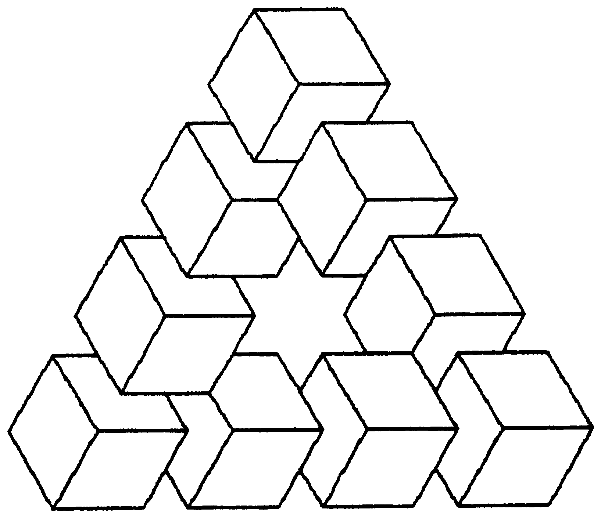  
*Fig. 17. Umulig figur*

</div>

Tegningen er lavet med sætningen:

```logo
startop 40 4
```

Proceduren `tohjørner` har tegnet den "anden" kasse på hver side, mens `ethjørne` har tegnet de øvrige.

Procedurerne er lavet således:

```logo
begynd ethjørne side
  tegn
  gentag 4
    frem side
    venstre 60
  hertil
  frem side/2
  løft
  frem side/2
  venstre 60
  frem side/2
  tegn
  frem side/2
  venstre 60
  kryds side
  løft
slut
```

---

<!-- Side 56 -->
```logo
begynd kryds side
  venstre 60
  frem side
  venstre 60
  frem side
  tilbage side
  højre 120
  frem side
  tilbage side
  venstre 60
  tilbage side
  højre 60
slut

begynd tohjørner side
  tegn
  gentag 3
    frem side
    venstre 60
  hertil
  frem side/2
  løft
  frem side/2
  venstre 60
  frem side
  venstre 60
  frem side/2
  tegn
  frem side/2
  venstre 60
  halvkryds side
  løft
slut

begynd halvkryds side
  venstre 60
  frem side
  venstre 60
  frem side/2
  tilbage side/2
  højre 120
  frem side
  tilbage side
  venstre 60
  tilbage side
  højre 60
slut
```

---

<!-- Side 57 -->
```logo
begynd startop side antal
  start
  løft
  sætxy -antal*side*3/4 -140
  gentag 3
    frem 3*side/2
    tohjørner side
    gentag antal-2
      frem 3*side/2
      ethjørne side
    hertil
    frem side
    venstre 60
    frem side
    venstre 60
  hertil
slut
```

---

<!-- Side 58 -->
# BILAG C. LÆSEVEJLEDNING FOR BEGYNDERE

Dette er en beskrivelse, der skal gøre det lettere for nybegyndere at starte med at bruge Mikro-Logo. Dette bilag er skrevet i "du-form", da det helst skal virke som en instruktør, der hjælper dig i gang.

## C.1 Opstart

Du må ikke bruge distributionsdisketten, når du vil "køre" Mikro-Logo. Derfor skal du lave en kopi af distributionsdisketten (se Betjeningsvejledningen for maskinen) og flytte filerne fra kopien af distributionsdisketten for Mikro-Logo over på en systemdiskette (se bilag B).

Når maskinen er startet op som beskrevet i brugervejledningen for maskinen, installeres grafikken (også beskrevet i brugervejledningen).

Mikro-Logo startes så op fra styresystemet (dvs. når der på skærmen står `A>` eller `B>` lige før markøren) ved at skrive `logo` og trykke på Retur-tasten (det er en af de store taster, der er markeret med ↵). Du skal sikre dig, at disketten med Mikro-Logo er den aktuelle disk (bogstavet før `>` angiver hvilken disk, der er den aktuelle). I brugervejledningen for maskinen er det beskrevet, hvorledes du skifter aktuel disk.

I brugervejledningen for maskinen er det også beskrevet, hvorledes du kan få maskinen til automatisk at starte op med Mikro-Logo, og hvorledes du kan indlægge Logo i en menu, så Mikro-Logo kan startes op fra menu-systemet.

---

<!-- Side 59 -->
## C.2 Simpel brug af Mikro-Logo

Når Mikro-Logo er startet op, vil der stå `LOGO>` i den nederste linie (kommandolinien). Det betyder, at Mikro-Logo er klar til at modtage kommandoer. Når du skriver kommandoer, kan du bl.a. bruge tasterne `←`, `→`, `⌫`, `SLET TEGN` og `TEGN IND` til at rette. Virkningen er beskrevet i kapitel 3, men ved at prøve at bruge dem, er det rimelig nemt at forstå virkningen af dem. Du skal bemærke, at det ikke er muligt at flytte markøren længere til venstre end det første tegn og længere til højre end en plads efter det sidste tegn.

Skriv nu `pil` i kommandolinien. Når du trykker på Retur-tasten (markeret med ↵), vil kommandoen blive udført. Det gælder altid, at der skal trykkes på Retur, for at kommandoerne i kommandolinien udføres. Markøren behøver ikke stå sidst i kommandolinien, når der trykkes på Retur.

Når kommandoen `pil` er udført, er der lavet en lille pil midt på skærmen. Denne pil markerer en skildpadde, som du kan dirigere ved at give den ordrer (også kaldet sætninger). Denne skildpadde har hele tiden en position og en retning (se figur 18.a).

Skriv derefter `frem 100` i kommandolinien. Skildpadden flyttes 100 skridt i skildpaddens retning, når der trykkes på Retur (se figur 18.b).

Hvis du nu skriver `venstre 90`, vil skildpadden ændre retning, 90 grader til venstre i forhold til, hvor den pegede før (se figur 18.c).

Lad os nu prøve med to ordrer i kommandolinien samtidig; de skal så adskilles med `;`

eks.: `frem 100; venstre 90`

Du skal bemærke, at ordren `venstre` er relativ i forhold til, hvad retning skildpadden har, når ordren gives (se figur 18.d).

---

<!-- Side 60 -->
<div align="center">

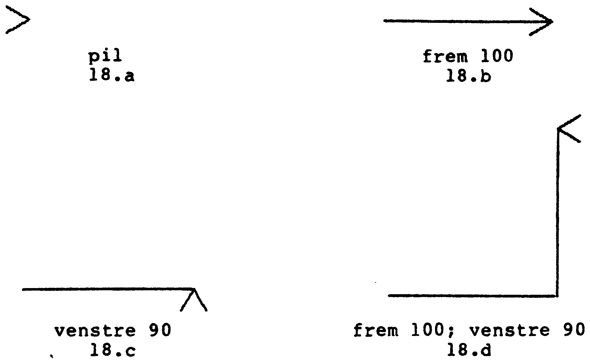  
*Fig. 18. Dele af en tegning*

</div>

Ved at trykke på tasten F1 (i den øverste række på tastaturet) fremkommer de sætninger, der stod i kommandolinien. Det er nu muligt at rette i denne linie, eller du kan udføre linien igen ved at trykke på Retur. Hvis du trykker F1 og Retur og gør dette endnu en gang, får du et kvadrat frem.

Der er selvfølgelig også andre sætninger, bl.a. `tilbage` og `højre`, som begge skal have et argument ligesom `frem` og `venstre`, og `start`, som visker tegningen ud og placerer skildpadden midt på skærmen. Prøv nu at bruge `start` og lav en tegning, så du får lidt øvelse i at styre skildpadden (du kan f.eks. tegne en trekant eller et af bogstaverne i dit navn).

Når du flytter skildpadden (f.eks. med `frem` eller `tilbage`), tegner den en streg. Det er også muligt at flytte uden at tegne. Endelig er det muligt at slette. Dette gøres ved henholdsvis `løft` og `slet`. Skildpadden sættes til at tegne

---

<!-- Side 61 -->
igen ved sætningen `tegn`. Hver gang du udfører sætningen `start`, vil skildpadden automatisk blive ændret til at tegne. Se eksemplerne i figur 19.

<div align="center">

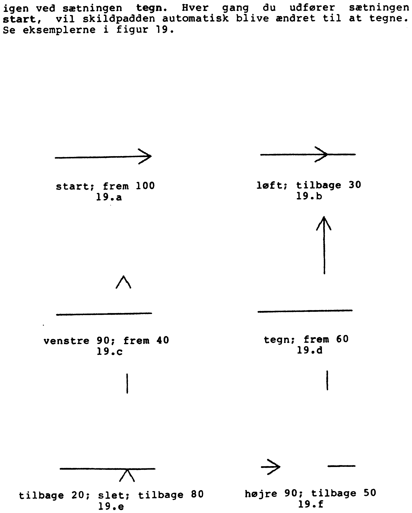  
*Fig. 19. Eksempel med løft og slet*

</div>

---

<!-- Side 62 -->
Du kan nu kigge på de tre eksempler i afsnit 4.2.5; du skal ikke bekymre dig om sætningerne `pilind`, `hvor` og `sætxy`; de forklares senere. Du kan også selv lave nogle eksempler.

Læs nu afsnit 4.1.1 om variable. Hvis du laver en tildelingssætning, f.eks. `vinkel := 90`, betyder det, at `vinkel` er en variabel, der har værdien 90, så `højre vinkel` betyder, at retningen ændres med 90 grader til højre. Variablen `vinkel` har værdien 90, men vi kan godt ændre værdien, f.eks. ved en ny tildelingssætning. Variable er meget anvendelige, når vi bruger procedurer, men de introduceres allerede nu, da de bruges i nogle af eksemplerne i afsnit 4.2. I afsnit 4.2 bruges også udtryk, som er parameter til f.eks. `frem`. Disse parametre kan være andet end tal, f.eks. `venstre 2*vinkel`, som drejer retningen 2 gange den aktuelle værdi af `vinkel` til venstre. Der må ikke være blanke ("mellemslag") i udtryk.

Med dette oplæg skulle det være muligt at læse hele afsnit 4.2 og danne sig et overblik over de simple sætninger. Læs også afsnit 4.3.1 (resten af 4.3 kan godt vente til senere).

Prøv nu at læse afsnit 4.4. Du vil måske støde på problemer undervejs, men læs bare videre, så du får en ide om hvilke andre sætninger, der findes.

Skriv nu `lær` i kommandolinien (husk Retur). Tegningen forsvinder nu, og der står `begynd` i den næstøverste linie. Det er nu muligt at skrive en procedure. Du kan enten skrive en af dem fra afsnit 4.4.4 eller selv lave en.

Du skal huske, at der kun må være een sætning i hver linie (dvs. ikke noget med `;`). Du behøver ikke bekymre dig om indrykning, sådan som alle eksemplerne i afsnit 4.4.4 har; systemet laver selv indrykninger i proceduren, når den er oversat.

Hvis du laver en fejl under indtastningen, kan du rette ved at bruge de samme taster, som du kunne bruge under retning i kommandolinien, og desuden tasterne `↑`, `↓`, og de 4 A-taster i den øverste række af tastaturet. Betydningen af de 4 A-taster står i linien lige over kommandolinien. Alle editeringstaster er beskrevet i afsnit 5.1.1. Når du er færdig med at skrive proceduren ind, trykker du på tasten A4, som oversætter proceduren. Hvis der er fejl i oversættelsen, kommer der en fejlmeddelelse i den øverste linie. (Fejlmeddelelserne er beskrevet i bilag E). Hvis der er en fejl, skriver du `ret` i kommandolinien og trykker på Retur, og når systemet beder om et procedurenavn, skriver du navnet på den procedure, du er ved at lave, og du får derved mulighed for at rette den.

---

<!-- Side 63 -->
Når proceduren er oversat korrekt, kan den udføres. Du skriver procedurenavnet efterfulgt af udtryk svarende til parametrene i kommandolinien, trykker på Retur, og proceduren udføres.

Du kan nu øve dig med at lave flere procedurer og udføre disse. Du kan f.eks. lave procedurer til at tegne stjerner eller blomster.

Når du er ved at oprette en procedure (kommandoen `lær`) eller rette en eksisterende procedure (kommandoen `ret`), kan du fortryde ved at trykke på ESC-tasten. Så bliver der ikke gjort noget ved proceduren, og systemet er igen klar til kommandoer. Kommandoen `hvilke` giver en oversigt over de procedurer, der er i systemet.

Når du har lavet nogle procedurer, kan du gemme dem på disketten, så du kan få fat i dem næste gang, du bruger Mikro-Logo. Dette gøres ved at udføre kommandoen `gem`. Den beder først om et procedurenavn — her er det ofte en fordel at skrive `alle`, idet dette betyder, at alle procedurer gemmes. Herefter beder den om et filnavn — du skriver her et navn på op til 8 bogstaver (dog ikke æ, ø og å) eller cifre.

Kommandoen `disk` giver oplysninger om hvilke filer, der indeholder Logo-procedurer på disketten. Procedurerne fra en fil kan hentes ind i systemet med kommandoen `hent`. Inden dette gøres, er det ofte en fordel at bruge kommandoen `glem` med procedurenavnet `alle`, da du herved sletter alle de procedurer, der er i systemet i forvejen. Dette er ofte en fordel, da oversættelsen er hurtigere, jo færre procedurer der er, og da der er en øvre grænse for, hvor mange procedurer der kan være i systemet.

Når du er færdig med at bruge Mikro-Logo for denne gang, bruger du kommandoen `farvel`. Inden skal du huske at gemme de procedurer, du har lavet eller ændret i, hvis du vil bruge dem senere.

Du bør nu læse hele afsnit 5.1 og 5.2 og derefter øve dig noget mere. Hvis du får problemer, skal du kigge i denne manual; her vil stikordsregistret ofte være en stor hjælp. På et tidspunkt skal du læse alle kapitlerne i denne manual, da dette bilag ikke er en udtømmende beskrivelse. Specielt kan kapitel 6 være anvendeligt, når du begynder at lave mere komplicerede tegninger med rekursive procedurer.

---

<!-- Side 64 -->
# BILAG D. ASCII TEGNSÆTTET

Dette er en tabel over tegnenes ASCII-værdier, som bruges i sætningerne `henttast` og `læstast` (se 4.3.2).

Nogle få af tegnene er blevet omdøbt, så hele det danske alfabet er med.

| Talværdi | ASCII tegn | Dansk tegn | | Talværdi | ASCII tegn | Dansk tegn |
| :---: | :---: | :---: | :---: | :---: | :---: | :---: |
| 0 | NUL | | | 32 | SPACE | |
| 1 | SOH | | | 33 | ! | |
| 2 | STX | | | 34 | " | |
| 3 | ETX | | | 35 | # | § |
| 4 | EOT | | | 36 | $ | |
| 5 | ENQ | | | 37 | % | |
| 6 | ACK | | | 38 | & | |
| 7 | BEL | | | 39 | ' | |
| 8 | BS | | | 40 | ( | |
| 9 | HT | | | 41 | ) | |
| 10 | LF | | | 42 | * | |
| 11 | VT | | | 43 | + | |
| 12 | FF | | | 44 | , | |
| 13 | CR | | | 45 | - | |
| 14 | SO | | | 46 | . | |
| 15 | SI | | | 47 | / | |
| 16 | DLE | | | 48 | 0 | |
| 17 | DC1 | | | 49 | 1 | |
| 18 | DC2 | | | 50 | 2 | |
| 19 | DC3 | | | 51 | 3 | |
| 20 | DC4 | | | 52 | 4 | |
| 21 | NAK | | | 53 | 5 | |
| 22 | SYN | | | 54 | 6 | |
| 23 | ETB | | | 55 | 7 | |
| 24 | CAN | | | 56 | 8 | |
| 25 | EM | | | 57 | 9 | |
| 26 | SUB | | | 58 | : | |
| 27 | ESC | | | 59 | ; | |
| 28 | FS | | | 60 | < | |
| 29 | GS | | | 61 | = | |
| 30 | RS | | | 62 | > | |
| 31 | US | | | 63 | ? | |

---

<!-- Side 65 -->
| Talværdi | ASCII tegn | Dansk tegn | | Talværdi | ASCII tegn | Dansk tegn |
| :---: | :---: | :---: | :---: | :---: | :---: | :---: |
| 64 | @ | | | 96 | ` | |
| 65 | A | | | 97 | a | |
| 66 | B | | | 98 | b | |
| 67 | C | | | 99 | c | |
| 68 | D | | | 100 | d | |
| 69 | E | | | 101 | e | |
| 70 | F | | | 102 | f | |
| 71 | G | | | 103 | g | |
| 72 | H | | | 104 | h | |
| 73 | I | | | 105 | i | |
| 74 | J | | | 106 | j | |
| 75 | K | | | 107 | k | |
| 76 | L | | | 108 | l | |
| 77 | M | | | 109 | m | |
| 78 | N | | | 110 | n | |
| 79 | O | | | 111 | o | |
| 80 | P | | | 112 | p | |
| 81 | Q | | | 113 | q | |
| 82 | R | | | 114 | r | |
| 83 | S | | | 115 | s | |
| 84 | T | | | 116 | t | |
| 85 | U | | | 117 | u | |
| 86 | V | | | 118 | v | |
| 87 | W | | | 119 | w | |
| 88 | X | | | 120 | x | |
| 89 | Y | | | 121 | y | |
| 90 | Z | | | 122 | z | |
| 91 | [ | Æ | | 123 | { | æ |
| 92 | \ | Ø | | 124 | \| | ø |
| 93 | ] | Å | | 125 | } | å |
| 94 | ^ | Ü | | 126 | ~ | ü |
| 95 | _ | | | 127 | DEL | |

---

<!-- Side 66 -->
*(Denne side er blank i originalen)*

---

<!-- Side 67 -->
# BILAG E. FEJLMEDDELELSER

Systemet har tre hovedfunktioner:

- udførelse af kommandoer
- oversættelse af sætninger
- udførelse af sætninger

hvor oversættelse og udførelse af sætninger gælder både sætninger skrevet i procedurer og sætninger skrevet i kommandolinien.

Under disse tre funktioner kan der forekomme forskellige fejl eller beskeder til brugeren. Når der er en fejl, betyder det, at systemet ikke kan fortsætte og må afbryde udførelsen eller oversættelsen. Når brugeren får en besked, betyder det, at systemet behøver mere information, eller at brugeren har lavet en fejl, men kan nå at rette den. I de nedenstående meddelelser bruges X som en ubekendt og kan være en vilkårlig streng af tegn.

## E.1 Udførelse af kommandoer

### E.1.1 Fejl ved udførelse af kommandoer

**`Hvad betyder X?`**  
X er ikke blevet genkendt som en lovlig kommando (eller sætning; denne fejl er derfor også nævnt i E.2.1).

**`X findes ikke`**  
Der er ikke nogen procedure, der hedder X.

**`Indre lager tomt`**  
Der er slet ikke defineret nogle procedurer. Fejlmeddelelsen kommer, når man giver `alle` med som procedurenavn.

**`Det er kun muligt at rette en procedure ad gangen`**  
Navnet `alle` er givet med som procedurenavn til kommandoen `ret`.

**`Sidste procedure kan ikke være i lageret`**  
Der er ikke plads til alle linier af den sidste procedure. Proceduren bliver derfor ikke gemt. Den kan først oprettes, når der er blevet slettet andre procedurer.

---

<!-- Side 68 -->
**`Ikke plads til denne linie`**  
Under udførelse af `kopi`, `tegnigen` eller `fortryd` kan brugeren komme ud for denne fejlmeddelelse, hvis der er blevet defineret procedurer siden sidste `glem alle`, `start` eller `viskud`. Denne meddelelse kan også forekomme, hvis der skrives sætninger i kommandolinien (se E.2.1).

**`Start kan ikke fortrydes`**  
**`Viskud kan ikke fortrydes`**  
Det er ikke muligt at fortryde sætninger, der laver `start` eller `viskud`.

**`Fil findes ikke`**  
Filen findes ikke på disketten.

**`Ingen plads på disketten`**  
Der er enten for mange filer på disketten, eller også er der for lidt plads til endnu en fil.

**`Filfejl nr. X`**  
Der er andre fejl ved en fil på disketten. Prøv at gentage kommandoen med en anden fil for at se, om det er filen eller disketten, der er fejl ved.

### E.1.2 Beskeder under udførelse af kommandoer

**`Fejl i begynd`**  
Efter editering er der ikke et `begynd` efterfulgt af et procedurenavn i den første linie. Ret proceduren eller afbryd med ESC.

**`For mange linier`**  
Efter editering er der for mange linier i proceduren (der er ikke plads til `slut`). Ret proceduren eller afbryd med ESC.

**`Proceduren er for lang - vil du rette den?`**  
Hvis kommandoen `lav` udføres, og der er udført mere end 19 sætninger fra kommandolinie siden sidste `glem alle`, `start` eller `viskud`, kan der ikke laves en procedure med alle sætninger. Men det er muligt at rette i proceduren indeholdende de første 19 sætninger eller de sidste 19 sætninger.

**`Ulovligt tegn i CCP/M filnavn`**  
Der er brugt andre tegn end bogstaver (dog ikke æ, ø og å) og cifre i et filnavn. Ret det eller afbryd med ESC.

---

<!-- Side 69 -->
**`Vil du slette eksisterende fil?`**  
Forsøg på at gemme på en fil, der allerede eksisterer. Brugeren skal bekræfte, at den gamle fil skal slettes.

**`Er der en skriver (plotter, Holger) koblet til?`**  
Brugeren skal fortælle, om de er sat til, når de skal bruges, og hvor de er sat til (på centralenheden eller disketteenheden).

## E.2 Oversættelse af sætninger

### E.2.1 Fejl ved oversættelse af sætninger

Hvis der findes fejl i oversættelsen af en sætning i en procedure udskrives udover fejlmeddelelsen også procedurenavnet og sætningen, så det er lettere at finde fejlen.

Hvis der er fejl i oversættelsen af en procedure, er der ingen procedurer, der kan udføres, før alle fejl er rettet.

**`Hvad betyder X?`**  
X er ikke genkendt som en sætning eller procedure (se også E.1.1).

**`Navn eller tal mangler`**  
Det er forventet, at der kommer et tal eller et variabelnavn, men der er slet ingen tegn.

**`Navn eller tal forventet, ikke X`**  
Som ovenfor, men det første tegn i X er hverken et ciffer eller et bogstav.

**`Ulovligt tal X`**  
X består af andet end cifre.

**`Ikke plads til tal`**  
Der er brugt mere end 40 forskellige tal.

**`Ikke plads til navn`**  
Der er brugt mere end 40 forskellige variabelnavne.

**`Højre-parentes mangler`**  
`)` mangler til at afslutte `(`.

---

<!-- Side 70 -->
**`tlf skal følges af (`**  
`tlf` kræver, at argumentet skal være i parenteser; der skal derfor komme en `(` lige efter `tlf`.

**`Fejl i udtryk ved X`**  
Der er mere tilbage i udtryk, men det starter ikke med en operator som forventet, men med X.

**`Mere end eet udtryk: X`**  
En sætning, der kræver præcis eet argument, efterfølges af X udover det ene udtryk.

**`Intet udtryk forventet: X`**  
En sætning, som ingen argumenter har, efterfølges af X.

**`X er ikke et navn`**  
Tildelings- og indlæsningssætninger samt `hvor` kræver, at argumenterne er variabelnavne, og det er X ikke.

**`For mange navne: X`**  
Der er mere (X) end de variabelnavne, der er argumenter til tildelings- og indlæsningssætninger samt `hvor`.

**`sætxy skal have 2 tal`**  
`sætxy` kræver 2 argumenter.

**`udport skal have 2 tal`**  
`udport` kræver 2 argumenter.

**`For mange løkker`**  
Der er for mange `gentag`- og `hvis`-sætninger inden i hinanden.

**`Fejl i løkke`**  
Der er `gentag`- eller `hvis`-sætninger, der ikke er afsluttet.

**`For mange ellers/sluthvis`**  
Der er flere `ellers`/`sluthvis`, end der er `hvis`.

**`For mange hertil`**  
Der er flere `hertil` end `gentag`.

**`hertil ventet`**  
Forsøg på at afslutte en `hvis`-sætning, men der er en `gentag`-sætning, der skal afsluttes først.

---

<!-- Side 71 -->
**`ellers/sluthvis ventet`**  
Forsøg på at afslutte en `gentag`-sætning, men der er en `hvis`-sætning, der skal afsluttes først.

**`Kun eet ellers`**  
Forsøg på at lave en `hvis`-sætning med flere `ellers`.

**`X (et procedurenavn) skal starte med et bogstav`**  
Et procedurenavn skal starte med et bogstav.

**`Højst 6 parametre`**  
En procedure må højst have 6 parametre.

**`X (en formel parameter) skal starte med et bogstav`**  
De formelle parametre skal være navne, der starter med et bogstav.

**`Parameterantal forkert`**  
Antal parametre i et procedurekald passer ikke med proceduredefinitionen.

**`For mange procedurer`**  
Der er defineret for mange procedurer.

**`Ikke plads til denne linie`**  
Kan forekomme, når der skrives sætninger i kommandolinien. Det er nødvendigt at slette procedurer for at gøre plads til at udføre denne sætningslinie. Denne meddelelse kan også forekomme ved kommandoerne `kopi`, `tegnigen` og `fortryd` (se også E.1.1).

**`Parameterstak fuld`**  
Det samlede antal udtryk fylder for meget. Det er nødvendigt at slette procedurer eller gøre nogle udtryk simplere for at undgå denne fejl.

**`sætning/begynd/slut er ikke tilladt`**  
Det er ikke tilladt at bruge `sætning` eller definere procedurer direkte i kommandolinien.

### E.2.2 Beskeder under oversættelse af sætninger

Der er ingen beskeder, da det ikke er muligt for brugeren at rette fejl i oversættelsen direkte. Brugeren skal rette fejl i procedurer ved kommandoen `ret`. Fejl i kommandolinien kan rettes ved at fremkalde kommandolinien med funktionstasten F1 og rette med editeringstasterne. Hvis der er fejl i oversættelsen af procedurer, er det ikke muligt at udføre nogle procedurer, før fejlen er rettet.

---

<!-- Side 72 -->
## E.3 Udførelse af sætninger

### E.3.1 Fejl ved udførelse af sætninger

**`Division med 0`**  
Det er ikke tilladt at dividere med nul.

**`Potens er negativ`**  
Det er ikke tilladt at opløfte til en negativ potens, da systemet kun regner med heltal.

**`tlf kræver et positivt tal`**  
Argumentet til `tlf` skal være et positivt tal.

### E.3.2 Beskeder under udførelse af sætninger

**`Ikke mere lager`**  
En rekursiv procedure er løbet mod grænsen for, hvor mange gange den kan udføres.

**`For mange linier, hvis lav, kopi eller tegnigen bruges`**  
Der er brugt for mange sætninger i kommandolinien siden sidste `glem alle`, `start` eller `viskud`. Hvis brugeren bruger en af kommandoerne `lav`, `kopi` eller `tegnigen`, vil det ikke give det rigtige resultat. Det anbefales at slette tegningen og lave procedurer til at lave dele af tegningen.

**`For mange tlf tal eller input - fortryd, kopi og tegnigen bliver forkerte`**  
Der er brugt for mange tilfældige tal og indlæsningssætninger siden sidste `glem alle`, `start` eller `viskud` i kommandolinien. Kommandoerne `fortryd`, `kopi` og `tegnigen` vil ikke give det rigtige resultat. Det anbefales at overveje at omstrukturere procedurerne, så der ikke bruges så mange indlæsninger og tilfældige tal og starte forfra på tegningen.

---

<!-- Side 73 -->
# BILAG F. OVERSIGT OVER SÆTNINGER OG KOMMANDOER

## F.1 Oversigt over sætninger

| Sætning og evt. argumenter | Beskrevet i afsnit |
| :--- | :--- |
| `frem udtryk` / `fr udtryk` | 4.2.1 |
| `tilbage udtryk` / `tb udtryk` | 4.2.1 |
| `venstre udtryk` / `ve udtryk` | 4.2.2 |
| `højre udtryk` / `hø udtryk` | 4.2.2 |
| `tegn` | 4.2.3 |
| `slet` | 4.2.3 |
| `løft` | 4.2.3 |
| `start` | 4.2.4 |
| `viskud` | 4.2.4 |
| `hjem` | 4.2.4 |
| `sætxy udtryk udtryk` | 4.2.1 |
| `sætx udtryk` | 4.2.1 |
| `sæty udtryk` | 4.2.1 |
| `drejtil udtryk` | 4.2.2 |
| `hvor variabel variabel variabel` | 4.2.4 |
| `pilind` | 4.2.4 |
| `pilud` | 4.2.4 |
| `variabel := udtryk` / `variabel = udtryk` | 4.3.1 |
| `henttal variabel` | 4.3.2 |
| `henttast variabel` | 4.3.2 |
| `læstast variabel` | 4.3.2 |
| `skriv udtryk` | 4.3.3 |
| `sætning tekst` | 4.3.3 |
| `udport udtryk udtryk` | 4.3.3 |

---

<!-- Side 74 -->
| Sætning og evt. argumenter | Beskrevet i afsnit |
| :--- | :--- |
| `hvis udtryk` <br> &nbsp;&nbsp;`sætninger` <br> `ellers` <br> &nbsp;&nbsp;`sætninger` <br> `sluthvis` | 4.4.2 |
| `hvis udtryk` <br> &nbsp;&nbsp;`sætninger` <br> `sluthvis` | 4.4.2 |
| `gentag udtryk` <br> &nbsp;&nbsp;`sætninger` <br> `hertil` | 4.4.3 |
| `begynd pnavn parameternavne` <br> &nbsp;&nbsp;`sætninger` <br> `slut` | 4.4.4 |
| `stop` | 4.4.4 |

---

<!-- Side 75 -->
## F.2 Oversigt over kommandoer og funktionstaster

| Kommando og evt. argumenter | Funktionstast | Beskrevet i afsnit |
| :--- | :---: | :--- |
| `lær` | F5 | 5.1.1 |
| `ret pnavn` | F6 | 5.1.1 |
| `lav pnavn` | | 5.1.1 |
| `list pnavn` | F2 | 5.1.2 |
| `plist pnavn` | | 5.1.2 |
| `hvilke` | F3 | 5.1.2 |
| `glem pnavn` | F4 | 5.1.2 |
| `disk` | F9 + Retur | 5.2 |
| `disk bogstav` | F9 + bogstav + Retur | 5.2 |
| `pdisk` | | 5.2 |
| `pdisk bogstav` | | 5.2 |
| `gem pnavn filnavn` | F11 | 5.2 |
| `tilføj pnavn filnavn` | F12 | 5.2 |
| `hent filnavn` | F10 | 5.2 |
| `fjern filnavn` | | 5.2 |
| `kopi` | F7 | 5.3 |
| `tegnigen` | | 5.3 |
| `holger` | | 5.3 |
| `plotter` | | 5.3 |
| `fortryd` | F8 | 5.4 |
| `pil` | | 5.4 |
| `status` | | 5.4 |
| `farvel` | | 5.4 |
| `hjælp` | | 5.4 |
| `phjælp` | | 5.4 |
| `R` / `Ctrl-F` | | 5.4 |
| `Ctrl-P` | | 5.3 |
| | F1 / `↖` | 3.2 |

---

<!-- Side 76 -->
# BILAG G. REGISTRE

## G.1 Oversigt over figurer

| Nr. | Titel | Side |
| :---: | :--- | :---: |
| 1. | Skærmen er inddelt i 3 felter | [3](#side-3) |
| 2. | Skærmbillede under udførelse af sætning | [5](#side-5) |
| 3. | Tegneområdets størrelse på en PICCOLINE | [7](#side-7) |
| 4. | Et kvadrat | [17](#side-17) |
| 5. | Kvadrat med markeret skildpadde | [18](#side-18) |
| 6. | Et M | [19](#side-19) |
| 7. | Et H | [20](#side-20) |
| 8. | H ændret til h | [21](#side-21) |
| 9. | Et hus | [24](#side-24) |
| 10. | To polygoner | [25](#side-25) |
| 11. | Spiral 2 90 | [29](#side-29) |
| 12. | Skærmbillede når en procedure rettes | [34](#side-34) |
| 13. | En gulv-skildpadde | [40](#side-40) |
| 14. | Polygon og cirkel | [49](#side-49) |
| 15. | Stjerner | [51](#side-51) |
| 16. | Spiraler | [53](#side-53) |
| 17. | Umulig figur | [55](#side-55) |
| 18. | Dele af en tegning | [60](#side-60) |
| 19. | Eksempel med løft og slet | [61](#side-61) |

---

<!-- Side 77 -->
## G.2 Stikordsregister

| Stikord | Side |
| :--- | :--- |
| accept i editor | 33 |
| afbryde udførelsen | 43 |
| aktuelle parametre | 25 |
| argumenter til kommandoer | 31 |
| begynd | 28 |
| betingelsessætninger | 26 |
| brugerdefineret sætning | se procedure |
| Ctrl-F | 42 |
| Ctrl-P | 41 |
| definition af procedure | 28 |
| disk | 37, 38 |
| diskette | 37 |
| diskettekommandoer | 37 |
| diskettestation | 37 |
| distributionsdiskette | 1, 48 |
| drejtil | 14 |
| editering, fortrydelse af | 33 |
| editeringstaster | 4 |
| editeringstaster i editor | 32 |
| editor | 32 |
| editor, accept i | 33 |
| editor, editeringstaster i | 32 |
| ellers | 26 |
| ESC | 5, 23, 31, 33, 36, 43 |
| farvel | 41 |
| fejl i oversættelse | 33 |
| fejlmeddelelser | 67 ff. |
| fil | 37 |
| filnavn | 37 |
| fjern | 39 |
| formelle parametre | 28 |
| fortegn | 9, 10 |
| fortryd | 42 |
| fortrydelse af editering | 33 |
| fr | 12 |
| frem | 12 |
| funktionstaster | 31, 75 |
| funktionsudtryk | 9 |
| gem | 38 |

---

<!-- Side 78 -->
| Stikord | Side |
| :--- | :--- |
| gentag | 27 |
| gentagelsessætninger | 27 |
| glem | 34, 35, 36, 39 |
| gulv-skildpadde | 39 |
| hent | 38 |
| henttal | 22 |
| henttast | 22 |
| hertil | 27 |
| hjem | 15 |
| hjælp | 42 |
| hvilke | 36 |
| hvis | 26 |
| hvor | 16 |
| hø | 14 |
| højre | 14 |
| indlæsningssætninger | 22 |
| installation | 48 |
| iterativ procedure | 52 |
| kommandoer | 3, 31 ff., 75 |
| kommandoer, argumenter til | 31 |
| kommandolinie | 3 |
| kontrolsætninger | 24 |
| kopi | 39 |
| lager | 42 |
| lav | 34, 35 |
| list | 36 |
| logisk eller | 11 |
| logisk og | 11 |
| Logo i undervisningen | 2 |
| lær | 32, 35 |
| læsevejledning | 1, 58 |
| læstast | 23 |
| løft | 15 |
| mellemrumstasten | 23, 36, 43 |
| operatorer | 8 |
| operatorer, prioritet af | 10 |
| opstart | 1, 58 |
| ordrer til skildpadde | se sætninger |
| oversættelse af procedurer | 33 |
| oversættelse, fejl i | 33 |
| overvåge udførelsen | 43 |
| parametre | 25, 28 |

---

<!-- Side 79 -->
| Stikord | Side |
| :--- | :--- |
| parametre, aktuelle | 25 |
| parametre, formelle | 28 |
| parentesudtryk | 9 |
| pdisk | 31, 38 |
| pentype | 15 |
| phjælp | 31, 42 |
| pil | 41 |
| pilind | 16 |
| pilud | 16 |
| plist | 31, 36 |
| plotter | 40 |
| position | 7, 12 |
| printer | se skriver |
| prioritet af operatorer | 10 |
| procedure | 24, 28 |
| procedure, definition af | 28 |
| procedure, udførelse af | se procedurekald |
| procedurehoved | 28 |
| procedurekald | 24 |
| procedurekommandoer | 32 |
| procedurekrop | 28 |
| procedurer, oversættelse af | 33 |
| rekursiv procedure | 29, 52 |
| relationelle operatorer | 10, 11 |
| ret | 32, 35 |
| retning | 7, 14 |
| Retur | 4, 23, 33, 43, 58 |
| skildpadde | 2, 7, 12 |
| skildpaddeordrer | se sætninger |
| skildpaddesætninger | se sætninger |
| skriv | 23 |
| skriver | 31 |
| skærmbillede | 3 |
| slet | 15 |
| slut | 28 |
| sluthvis | 26 |
| start | 16, 34, 35, 39 |
| status | 41 |
| stop | 30 |
| systemdiskette | 48 |
| sætning | 23 |
| sætninger | 4, 7 ff., 73 |
| sætningslinie | 4 |
| sætx | 13 |
| sætxy | 13 |
| sæty | 13 |

---

<!-- Side 80 -->
| Stikord | Side |
| :--- | :--- |
| talkonstanter | 9 |
| tb | 12 |
| tegn | 15 |
| tegneområde | 3, 5, 7, 13 |
| tegnesætninger | 12 |
| tegnigen | 39 |
| tilbage | 12 |
| tildelingssætninger | 22 |
| tilføj | 38 |
| tlf | 9 |
| udførelse af kommandolinie | 4 |
| udførelse af procedure | se procedurekald |
| udførelsen, afbryde | 43 |
| udførelsen, overvåge | 43 |
| udlæsningssætninger | 23 |
| udport | 23 |
| udtryk | 8 ff. |
| variabel | 8, 9 |
| ve | 14 |
| venstre | 14 |
| viskud | 15, 34, 35, 39 |

---

<!-- Side 81 -->
# LÆSERBEMÆRKNINGER

**Titel:** Mikro-Logo Brugervejledning  
**RCSL Nr.:** 29 0 00852  

A/S Regnecentralen af 1979 bestræber sig på at forbedre kvalitet og brugbarhed af sine publikationer. For at opnå dette ønskes læserens kritiske vurdering af denne publikation.

Kommenter venligst manualens fuldstændighed, nøjagtighed, disposition, anvendelighed og læsbarhed:

<br>

Angiv fundne fejl (reference til sidenummer):

<br>

Hvordan kan manualen forbedres:

<br>

Andre kommentarer:

<br>

**Navn:**  
**Stilling:**  
**Dato:**  

*På forhånd tak!*

---

<!-- Side 82 -->
<div align="center">

*Riv ikke - Fold her og hæft.*

```
                                                  Frankeres
                                                     som
                                                    brev

                    REGNECENTRALEN
                    af 1979
                    Informationsafdelingen
                    Lautrupbjerg 1
                    2750 Ballerup
```

</div>
